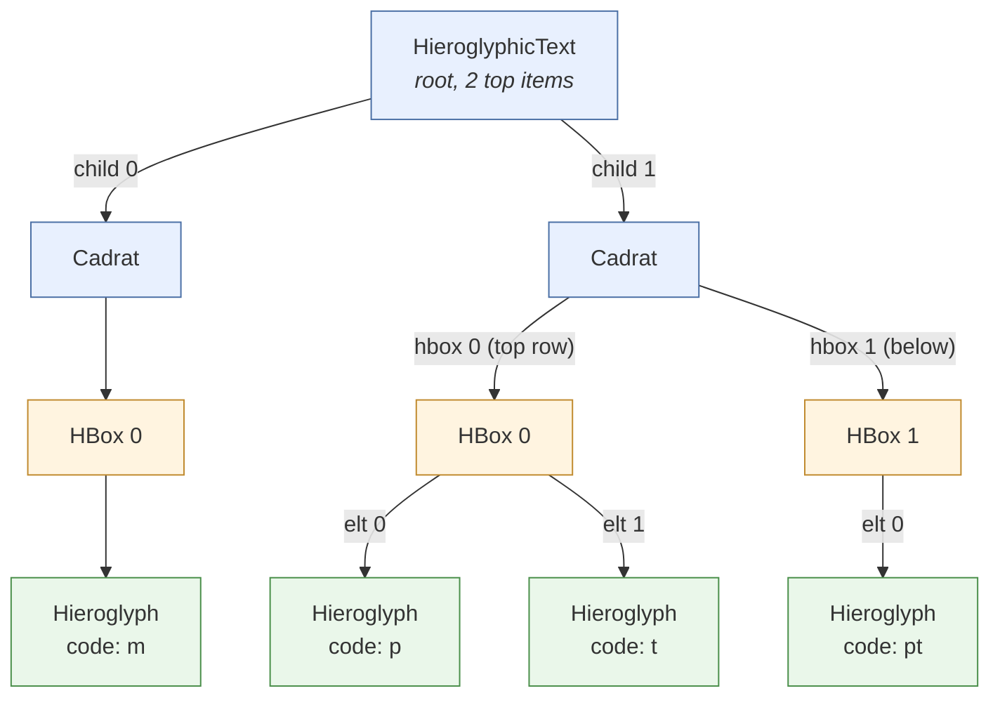

# Cursor and edition

In **tksesh,**, the cursor could be moved *inside* quadrats. This feature can be useful for *advanced selection* (e.g. selecting a word for search in a dictionary), for *editing*, and is quite necessary if one day we add the notion of **zones** in the text (i.e. boxes which contain multiple columns or lines). Zones, and a view structure that suits them, are designed in [Box tree and zones](boxTree.md).

## Position

### MDCPosition

The first step has been to redesign `MDCPosition`. We had introduced this class to represent a position in the text, with a representation as a simple integer. A position falls between two entries in the text, which makes them logically sound. For instance, if we have the text `ab`, 0 is the position before `a`, 1 is the position between `a` and `b`, and 2 is the position after `b`.

The current `MDCPosition` class contains a *list* of integers. The last one follows the logic of the previous version: it's a position **between** entries. The beginning of the list indicates in which component of the structure we are, so it's the **index of an element**

For a text like `m-p*t:pt`, which actual structure is :



If we want to represent the position just after `p`, we can use the following list of integers: `(1,0,1)` : child 1, hbox 0, and position 1.

The positions after the final "pt" are `(1,1,1)` (the end of the second row, *inside* the quadrat), then `(1,2)` (the bottom of the quadrat, still inside) and `(2)` (outside).

The edges of rows (`HBox`) and quadrats (`Cadrat`) are therefore **two different places**, one inside and one outside:

| position | where | typing a sign... |
|---|---|---|
| `(1)` | before the quadrat | adds a quadrat |
| `(1,0)` | top of the quadrat | adds a row on top |
| `(1,0,0)` | start of the first row | adds an element at the start of the row (`x*p*t`) |
| `(1,0,2)` | end of the first row | adds an element at the end of the row (`p*t*x`) |
| `(1,2)` | bottom of the quadrat | adds a row at the bottom |
| `(2)` | after the quadrat | adds a quadrat |

A quadrat with a single sign has four inner stops: `(q,0)`, `(q,0,0)`, `(q,0,1)` and `(q,1)`. Ligatures do not work this way (yet): their edges still coincide with the gap around them.

### MDCMark and MDCCaret

To handle selection, JSesh uses two notions. The first one is the `MDCMark`. Basically, a mark is a selected place in a text. The difference between a mark and a position is that the mark can handle text modification. If you delete text before a mark, the mark will move accordingly. It's inspired by marks in the tk text widget, or marks in the Emacs editor.

A MDCCaret is a pair containing the cursor **position** and an optional **selection mark**. 

modifications linked with the new `MDCPosition` are relatively straightforward there.

The enum `CaretGranularity` is used to define the kind of movement we want to perform when moving the caret.

### MDCRange

We used to define a range by a couple of positions, which was kept in an array if size 2. `MDCRange`is basically a replacement for this array, with the added feature that it's ordered by construction.

### Moving the cursor

Moving the cursor is handled by a `PositionNavigator`, built for a text. The principle of this class is quite simple: it can compute a list of possible sequential positions (called stops), and moving the cursor implies moving along this list. Stops are defined according to the selected `CaretGranularity`.

With `INNER`, the stops are the interior gaps of the quadrats, rows and ligatures, plus the edge gaps of rows and quadrats (`ModelElement.edgeGapsAreInnerStops()`, true for `HBox` and `Cadrat`). Moving right through `p*t:pt` thus visits `(1)`, `(1,0)`, `(1,0,0)`, `(1,0,1)`, `(1,0,2)`, `(1,1)`, `(1,1,0)`, `(1,1,1)`, `(1,2)` and `(2)`.

## Cursor drawing

In the previous versions of the software, the cursor was drawn by the method `ViewDrawer.drawViewAndCursor`, which drew the view, and which checked, at each step, if we were at the cursor position. The cursor drawing has now been separated from the view drawing (even if the view drawing still handles the **selection**).

Now, a `TextGeometry`, built for the root view and the current `JSeshStyle`, computes where the cursor and nested selections are drawn, from the view tree only. It returns shapes which paint themselves: the editing components (`JMDCField` and `JMDCEditor`) do `new TextGeometry(view, style).cursorAt(caret).ifPresent(c -> c.paint(g, style))`. The shapes are expressed in the coordinate system of the `Graphics2D` given to `ViewDrawer`.

Behind it, the package-private `CursorLocator` and `SelectionLocator` walk the view tree through `PlacedView`: a view together with the transform from its own coordinate system to the root's. It follows model paths down the views, checks that views and model still match, and gives the bounds of subviews. The bounds themselves, including the mirroring of right-to-left views, come from `MDCView.getSubViewBounds` and `MDCView.layoutToDrawing`, which `ViewDrawer` uses too.

Inside a quadrat, the direction of the cursor is read from the geometry of the two subviews around the gap, as the layout has placed them: subviews apart horizontally are separated by a vertical line, subviews apart vertically by a horizontal one, and otherwise (overlapping or diagonal parts, as in complex ligatures) the line cuts across the direction in which their centres are farthest apart. The kind of container is not consulted, so the cursor can't disagree with the layout (an earlier version, with one visitor method per kind of container, drew a horizontal line in ligatures whose signs were side by side). A few questions are still asked to the model: `ModelElement.edgeGapsAreStops()` (lists of quadrats, whose first and last gaps have a cursor of their own), `ModelElement.edgeGapsAreInnerStops()` and `ModelElement.stacksChildren()` (rows and quadrats, see below) and `ModelElement.placesChildrenFreely()` (absolute groups, where the gap is an order rather than a place, so the end of the preceding sign is marked).

At the edge of a row or of a quadrat there is no pair of subviews to read the direction from. The cursor is then a thin line at the edge of the first or last subview: vertical at the ends of a row, horizontal at the top and bottom of a quadrat (`stacksChildren()` says which). It is thin, and so differs from the thick cursor between quadrats.

## Mouse clicks

`TextGeometry.positionAt(point)` (implemented by the package-private `PositionLocator`) turns a point into a position. A click puts the cursor in a gap of a *sequence of items*: the text itself, or a text in miniature such as the content of a cartouche (and, later, zones). These are the sequences that the cursor reaches in `QUADRAT` mode (`ModelElement.isCursorStop(0, CaretGranularity.QUADRAT)`), whatever the current granularity: a click is not an arrow key.

A click never goes *inside* a quadrat or a sub-quadrat. A cursor placed there by a mouse click would be more disturbing than useful, so the click is resolved to the gap before or after the whole quadrat (in the sequence which contains it). A click on the frame of a cartouche, outside its content, treats the cartouche as a unit, too.

Inside a text in miniature, which is a single row (or column), the gap is the one nearest to the point, even if the point falls between quadrats or in the margin. The top-level text also knows about lines: a click after the end of a line goes to the end of this line.

## Selection drawing

Selections at the top level are drawn by `ViewDrawer` itself. Selections in a nested scope (inside a cartouche...) are computed by `TextGeometry.selection`, which returns a `SelectionShape` that `ViewDrawer` asks to paint.

## Sub-quadrat edition

Editing **inside** quadrats and cartouches is a bit tricky. Some edits are possible at certain positions, but not at others. Basically, when editing the text in a cartouche, we expect more or less to have all facilities to build quadrats.

When editing inside a quadrat, options are more limited.

### InnerEdit

If the cursor is not at a place where “standard” edits are possible, the `JMDCEditorWorkflow` uses an `InnerEdit`, built for a text and a position (`new InnerEdit(text, position).insertSign(sign)`, `.deleteBefore()`, `.deleteAfter()`). It computes the new version of the top item and the new cursor position; the workflow then replaces the top item.

What is done depends on the container, and the containers decide it themselves: `Cadrat`, `HBox` and `Ligature` implement `InnerEditable` (`insertSignAt`, `disappearsWhenEmpty`, `simplifyElementAt`). Likewise, which gaps are stops is decided by `ModelElement.isCursorStop(gap, granularity)` (built on `isNavigable()` and `edgeGapsAreStops()`), which `PositionNavigator` uses. Bringing a position to the nearest stop is done by `TopItem.canonicalize`, so that `InnerEdit` can compute the new cursor position in its edited copy of the top item, before it is put in the text.

At the edges of a row or of a quadrat, insertion adds to the container (see the table in the position section), and the cursor stays inside it, so successive signs are appended to the same row. There is nothing to delete on the outer side: Backspace at the start of a row or at the top of a quadrat, and Delete at the end of a row or at the bottom of a quadrat, do nothing. The cursor has to be moved away first.

### Editing Cartouches (and other text scopes)

To handle regular text editing and cartouche editing, we have introduced the notion of **TextScope**. A text scope is a path in the text for a place where regular edit can take place.

And `EditingScope` is the combination of a text and of a `TextScope`. Actual edits happen in the context of an `EditingScope`.

Changes in the previous versions of the code are mostly that in this case the scope is passed in the command chain:

```java
public class HieroglyphicTextModel {
    ...
  public void replaceElement(TextScope scope, int gap1, int gap2, List<TopItem> newElements) {
      undoManager.doCommand(new CommandFactory().buildReplaceCommand(text, scope, newElements, gap1, gap2,
                  isClean()));
  }
}
```

Ultimately, the command will insert the right elements in the list designated by the scope.

