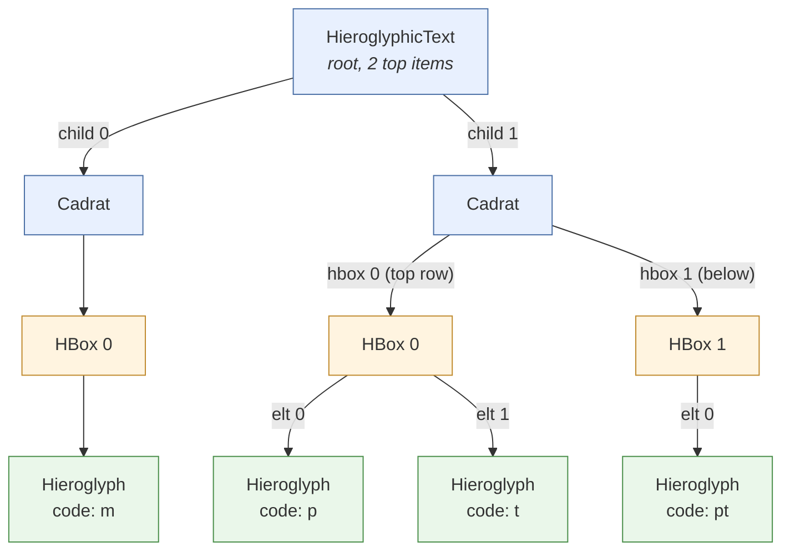

# Cursor and edition

In **tksesh,**, the cursor could be moved *inside* quadrats. This feature can be useful for *advanced selection* (e.g. selecting a word for search in a dictionary), for *editing*, and is quite necessary if one day we add the notion of **zones** in the text (i.e. boxes which contain multiple columns or lines).

## Position

### MDCPosition

The first step has been to redesign `MDCPosition`. We had introduced this class to represent a position in the text, with a representation as a simple integer. A position falls between two entries in the text, which makes them logically sound. For instance, if we have the text `ab`, 0 is the position before `a`, 1 is the position between `a` and `b`, and 2 is the position after `b`.

The current `MDCPosition` class contains a *list* of integers. The last one follows the logic of the previous version: it's a position **between** entries. The beginning of the list indicates in which component of the structure we are, so it's the **index of an element**

For a text like `m-p*t:pt`, which actual structure is :



If we want to represent the position just after `p`, we can use the following list of integers: `(1,0,1)` : child 1, hbox 0, and position 1.

In theory, the positions after the final "pt" would be `(1,1,1)`, and moving forward we would find `(1,1)` and then `(2)`.

(currently, we still need to settle this in the edition scheme).

### MDCMark and MDCCaret

To handle selection, JSesh uses two notions. The first one is the `MDCMark`. Basically, a mark is a selected place in a text. The difference between a mark and a position is that the mark can handle text modification. If you delete text before a mark, the mark will move accordingly. It's inspired by marks in the tk text widget, or marks in the Emacs editor.

A MDCCaret is a pair containing the cursor **position** and an optional **selection mark**. 

modifications linked with the new `MDCPosition` are relatively straightforward there.

The enum `CaretGranularity` is used to define the kind of movement we want to perform when moving the caret.

### MDCRange

We used to define a range by a couple of positions, which was kept in an array if size 2. `MDCRange`is basically a replacement for this array, with the added feature that it's ordered by construction.

### Moving the cursor

Moving the cursor is handled by a `PositionNavigator`, built for a text. The principle of this class is quite simple: it can compute a list of possible sequential positions (called stops), and moving the cursor implies moving along this list. Stops are defined according to the selected `CaretGranularity`.

## Cursor drawing

In the previous versions of the software, the cursor was drawn by the method `ViewDrawer.drawViewAndCursor`, which drew the view, and which checked, at each step, if we were at the cursor position. The cursor drawing has now been separated from the view drawing (even if the view drawing still handles the **selection**).

Now, a `TextGeometry`, built for the root view and the current `JSeshStyle`, computes where the cursor and nested selections are drawn, from the view tree only. It returns shapes which paint themselves: the editing components (`JMDCField` and `JMDCEditor`) do `new TextGeometry(view, style).cursorAt(caret).ifPresent(c -> c.paint(g, style))`. The shapes are expressed in the coordinate system of the `Graphics2D` given to `ViewDrawer`.

Behind it, the package-private `CursorLocator` and `SelectionLocator` walk the view tree through `PlacedView`: a view together with the transform from its own coordinate system to the root's. It follows model paths down the views, checks that views and model still match, and gives the bounds of subviews. The bounds themselves, including the mirroring of right-to-left views, come from `MDCView.getSubViewBounds` and `MDCView.layoutToDrawing`, which `ViewDrawer` uses too.

Inside a quadrat, the direction of the cursor is read from the geometry of the two subviews around the gap, as the layout has placed them: subviews apart horizontally are separated by a vertical line, subviews apart vertically by a horizontal one, and otherwise (overlapping or diagonal parts, as in complex ligatures) the line cuts across the direction in which their centres are farthest apart. The kind of container is not consulted, so the cursor can't disagree with the layout (an earlier version, with one visitor method per kind of container, drew a horizontal line in ligatures whose signs were side by side). Two questions are still asked to the model: `ModelElement.edgeGapsAreStops()` (lists of quadrats, whose first and last gaps have a cursor of their own) and `ModelElement.placesChildrenFreely()` (absolute groups, where the gap is an order rather than a place, so the end of the preceding sign is marked).

## Selection drawing

Selections at the top level are drawn by `ViewDrawer` itself. Selections in a nested scope (inside a cartouche...) are computed by `TextGeometry.selection`, which returns a `SelectionShape` that `ViewDrawer` asks to paint.

## Sub-quadrat edition

Editing **inside** quadrats and cartouches is a bit tricky. Some edits are possible at certain positions, but not at others. Basically, when editing the text in a cartouche, we expect more or less to have all facilities to build quadrats.

When editing inside a quadrat, options are more limited.

### InnerEdit

If the cursor is not at a place where “standard” edits are possible, the `JMDCEditorWorkflow` uses an `InnerEdit`, built for a text and a position (`new InnerEdit(text, position).insertSign(sign)`, `.deleteBefore()`, `.deleteAfter()`). It computes the new version of the top item and the new cursor position; the workflow then replaces the top item.

What is done depends on the container, and the containers decide it themselves: `Cadrat`, `HBox` and `Ligature` implement `InnerEditable` (`insertSignAt`, `disappearsWhenEmpty`, `simplifyElementAt`). Likewise, which gaps are stops is decided by `ModelElement.isCursorStop(gap, granularity)` (built on `isNavigable()` and `edgeGapsAreStops()`), which `PositionNavigator` uses. Bringing a position to the nearest stop is done by `TopItem.canonicalize`, so that `InnerEdit` can compute the new cursor position in its edited copy of the top item, before it is put in the text.

### Editing Cartouches (and other text scopes)

To handle regular text editing and cartouche editing, we have introduced the notion of **TextScope**. A text scope is a path in the text for a place where regular edit can take place.

And `EditingScope` is the combination of a text and of a `TextScope`. Actual edits happen in the context of an `EditingScope`.

Changes in the previous versions of the code are mostly that in this case the scope is passed in the command chain:

```java
public class HieroglyphicTextModel {
    ...
  public void replaceElement(TextScope scope, int gap1, int gap2, List<TopItem> newElements) {
      undoManager.doCommand(new CommandFactory().buildReplaceCommand(text, scope, newElements, gap1, gap2,
                  isClean()));
  }
}
```

Ultimately, the command will insert the right elements in the list designated by the scope.

