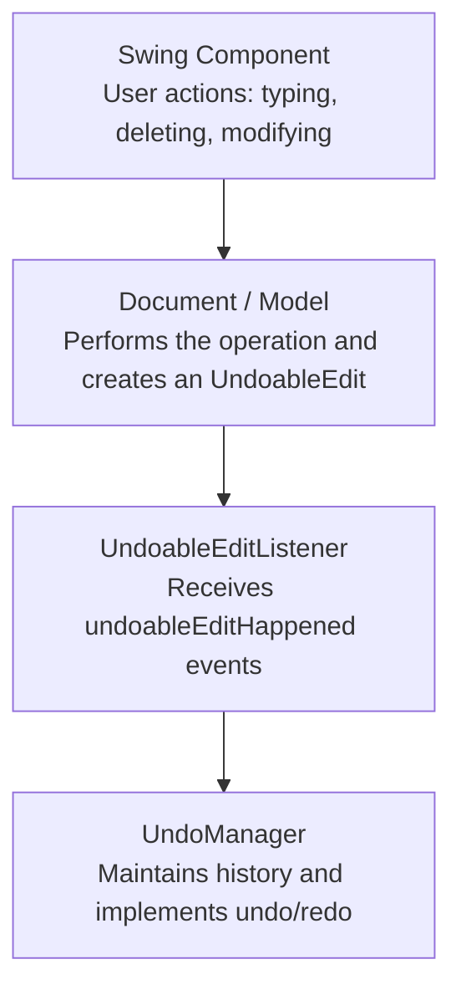
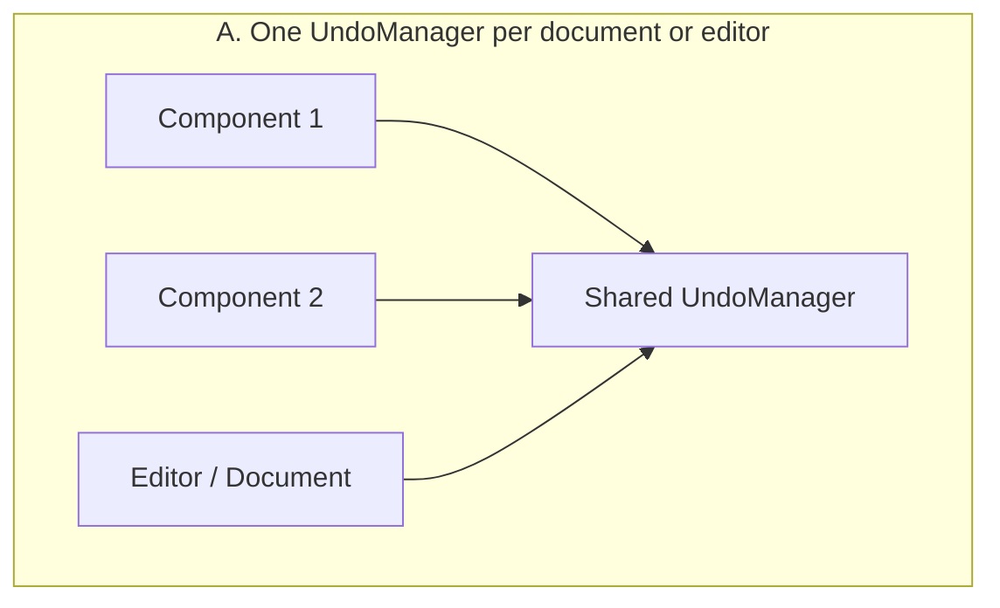
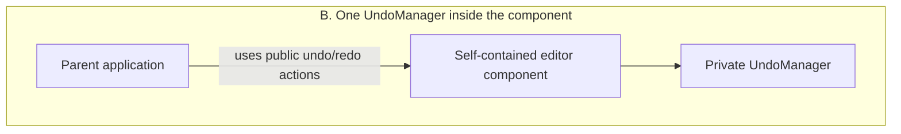

# Undo/Redo Architecture for a Custom Swing Component

In Swing, the standard architecture for undo/redo is based on the `javax.swing.undo` package, particularly `UndoableEdit`, `UndoManager`, and `UndoableEditSupport`. The essential idea is to separate the component's editing operations from the mechanism that maintains the undo/redo history.

## 1. The standard Swing architecture

The following diagram shows the typical flow from a user action to the undo history.



The responsibilities are as follows:

- **The component** handles user interaction and rendering.
- **The model or document** implements the actual editing operations and knows how to reverse them.
- **`UndoableEdit`** represents one reversible operation.
- **`UndoManager`** stores edits and determines which operation can be undone or redone next.
- **`UndoableEditListener`** connects the editing model to the history manager.

The key design decision is that the component does not itself maintain an undo stack. The history is usually managed externally, allowing the same undo mechanism to be reused by menus, keyboard shortcuts, toolbars, and other UI elements.

## 2. Implementing a custom component

Suppose you are writing a component that edits a value in a domain model. The operation might be changing a colour, modifying an element's position, or editing a hieroglyphic sequence.

A useful approach is to:

- Keep the domain model independent of Swing.
- Represent each meaningful modification as an `UndoableEdit`.
- Expose undoable edits from the model or its editing service.
- Let the enclosing application or editor own the `UndoManager`.

For example, an edit representing a change of value could look like this:

```java
public final class ChangeValueEdit extends AbstractUndoableEdit {
    private final MyModel model;
    private final String oldValue;
    private final String newValue;

    public ChangeValueEdit(
            MyModel model,
            String oldValue,
            String newValue) {
        this.model = model;
        this.oldValue = oldValue;
        this.newValue = newValue;
    }

    @Override
    public void undo() {
        super.undo();
        model.setValue(oldValue);
    }

    @Override
    public void redo() {
        super.redo();
        model.setValue(newValue);
    }

    @Override
    public String getPresentationName() {
        return "Change value";
    }
}
```

Here, `MyModel` is a placeholder for your actual domain class. The important point is that undo and redo restore the old and new states, respectively. The model's setter must update any relevant observers or views, but it should not accidentally generate another undoable edit during replay.

The component or editing service can create an edit after a successful change:

```java
String oldValue = model.getValue();
model.setValue(newValue);

undoableEditSupport.postEdit(
    new ChangeValueEdit(model, oldValue, newValue)
);
```

With a field such as:

```java
private final UndoableEditSupport undoableEditSupport =
        new UndoableEditSupport(this);
```

the owning editor registers its `UndoManager` as a listener:

```java
undoableEditSupport.addUndoableEditListener(undoManager);
```

This is one use case for `UndoableEditSupport`. It is a convenient event broadcaster, but it is optional: you can instead call `undoManager.addEdit(edit)` directly, or implement `UndoableEditListener` in your own controller or application service.

## 3. Connecting Undo/Redo to Swing actions

The standard Swing approach is to use `Action` objects for the Undo and Redo commands. This allows the same commands to be attached to menu items, toolbar buttons, and keyboard shortcuts.

For example:

```java
UndoManager undoManager = new UndoManager();

Action undoAction = new AbstractAction("Undo") {
    @Override
    public void actionPerformed(ActionEvent e) {
        if (undoManager.canUndo()) {
            undoManager.undo();
        }
    }
};

Action redoAction = new AbstractAction("Redo") {
    @Override
    public void actionPerformed(ActionEvent e) {
        if (undoManager.canRedo()) {
            undoManager.redo();
        }
    }
};
```

In a complete implementation, you would also update the actions' enabled states and presentation names whenever the undo history changes. You can use `getUndoPresentationName()` and `getRedoPresentationName()` to produce menu labels such as "Undo Change Value" and "Redo Change Value".

For keyboard shortcuts, use the component's `InputMap` and `ActionMap`, rather than installing a separate `KeyListener`.

## 4. Where should the UndoManager live?

This is an important architectural question. There are two common approaches.



**A. One `UndoManager` per document or editor**

Each open document or editing session owns its own history. All components modifying that document submit their edits to the same manager. This allows a single Undo command to reverse changes across multiple views of the same document.



**B. One `UndoManager` inside the component**

This is reasonable if the component represents an independent editing session and its undo history should remain private. The enclosing application can expose the component's undo and redo actions without knowing its internal implementation.

For a reusable component, I would normally favour **A**, with a clear way for the parent editor to supply or associate an undo history. This avoids forcing every instance of the component to have an independent history when several components actually edit the same document.

## 5. Compound edits and grouping

Swing also provides `CompoundEdit`, which groups several smaller edits into one logical operation. This is useful when a single user action changes multiple elements.

For example, moving a group of objects should normally be undone as one operation, rather than requiring the user to undo each object's movement separately.

```java
CompoundEdit compound = new CompoundEdit();

compound.addEdit(edit1);
compound.addEdit(edit2);
compound.addEdit(edit3);

compound.end();
undoManager.addEdit(compound);
```

The enclosing operation becomes one entry in the undo history. You can also implement edit coalescing through `UndoableEdit.addEdit()`, for example to group consecutive keystrokes into a single undo operation.

## 6. Practical recommendations

For a new Swing component, follow these principles:

- **Model changes are the source of truth.** Undo and redo should reverse actual model operations, not merely restore the component's displayed state.
- **Use meaningful operations.** An edit should generally represent a user-level operation, not every low-level property assignment.
- **Keep the history outside the view.** Unless the component is a standalone editor, let the enclosing document or controller own the `UndoManager`.
- **Use `CompoundEdit` for atomic user operations.** A complex operation should normally be undone as one unit.
- **Handle non-undoable changes explicitly.** Loading a new document, for example, may require calling `discardAllEdits()` rather than adding an edit to the history.
- **Be careful with edit lifetimes.** An edit retains whatever objects it references, so a long undo history can keep an otherwise closed document or large object graph alive.

The official reference is the Java documentation for [`javax.swing.undo`](https://docs.oracle.com/en/java/javase/25/docs/api/java.desktop/javax/swing/undo/package-summary.html). It also describes `StateEdit`, which is useful when capturing and restoring object state is more convenient than implementing individual inverse operations.

## Recommendation

Treat undo/redo as an application-level editing service, use Swing's `UndoManager` for history management, and make the component publish meaningful `UndoableEdit` instances. This keeps the component reusable and prevents the undo mechanism from becoming entangled with its rendering and event-handling code.
