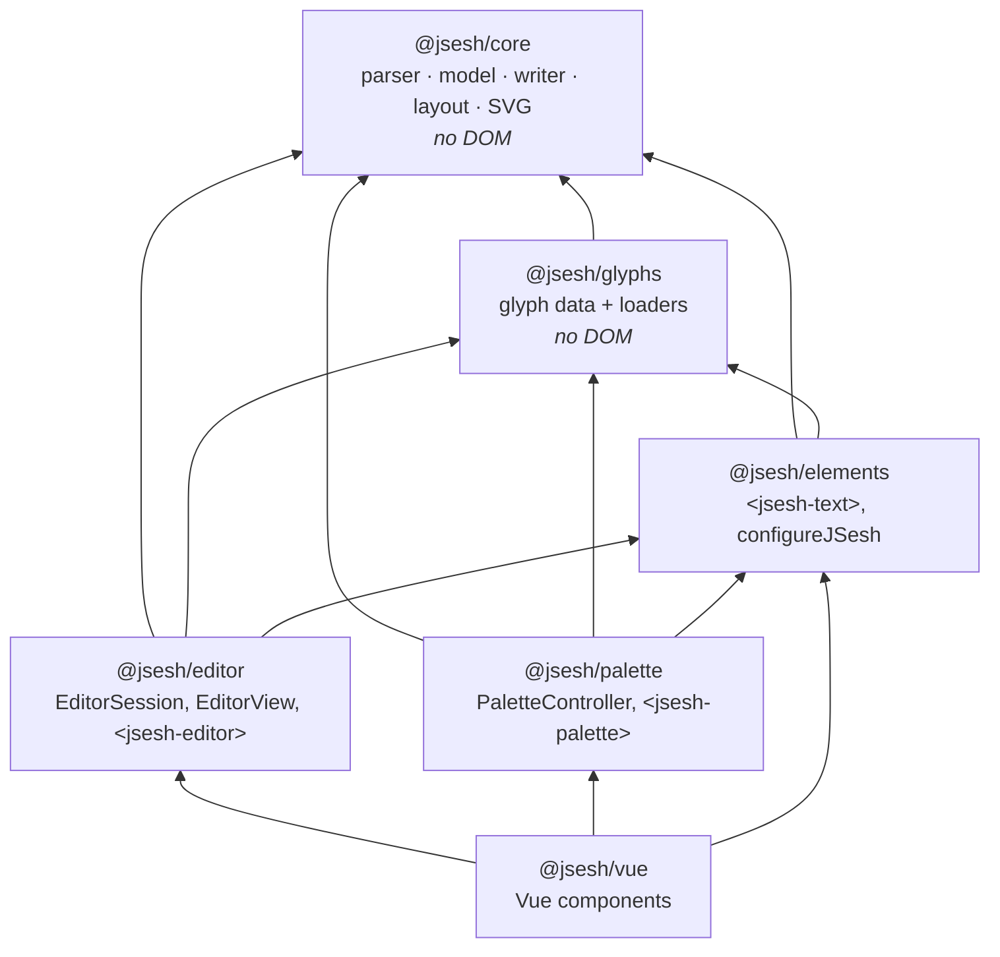
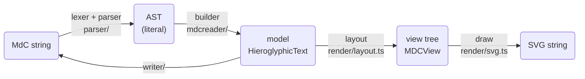
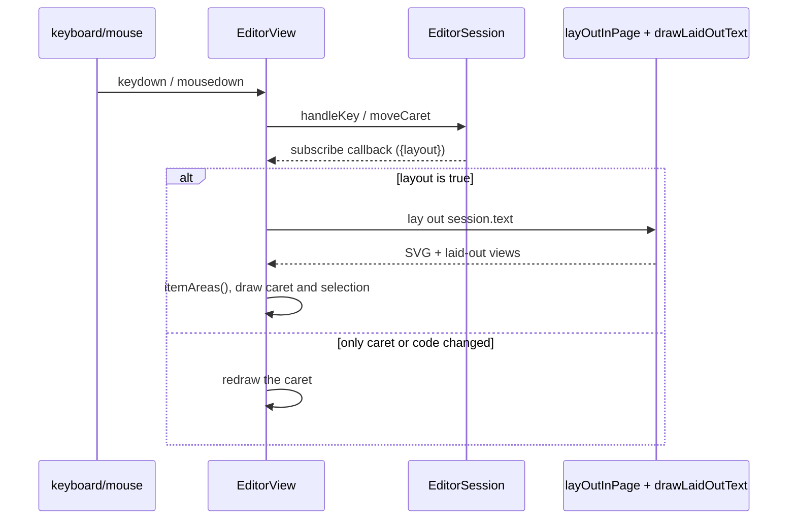

# JSeshJs maintainer guide

This guide explains how JSeshJs is organised and why, for people who work on its code. For using the library, see the [user guide](user-guide.md); for bending it to your needs without changing it, the [customisation guide](customisation.md). How to build and test is also summarised in the [README](../README.md).

## 1. The one rule: it is a port

JSeshJs is a TypeScript **port** of the Java application ([JSesh](https://jsesh.qenherkhopeshef.org), the rest of this repository). Its purpose is to draw a text *exactly* as JSesh does, so that a page and the desktop program agree to the pixel.

From this follow the working principles:

- **Java is the reference.** A behaviour of the layout, the parser or the writer is right if Java does the same. When they differ, the Java code is probably right, and the fix is made in TypeScript, unless the Java is wrong, in which case it is fixed there first and the fixtures regenerated.
- **The code follows the Java classes closely, names included.** `LineLayout`, `QuadratLayout`, `Zone`, `HieroglyphDrawer`, `ModelElementAdapter`... exist in both. Every file starts with a comment saying which Java class it ports. This is deliberate: it lets you compare both side by side, and port a Java change line by line. Don't "tidy up" the structure of a ported file without a strong reason.
- **Java `float`s are reproduced.** Java computes sizes in `float` (32 bits), and a rounding difference can move a sign by a visible amount after a few operations. The layout therefore wraps its arithmetic in `Math.fround` (`const f = Math.fround;` at the top of the files). Leave these calls in place, and add them when you port new arithmetic.
- **The fixtures are the specification.** The Java side exports its results (parse trees, written MdC, view trees), and the tests check that the TypeScript code gives the same ones. See [Testing](#7-testing).
- **Not everything is ported.** The JS port covers parsing, the model, writing MdC, layout, SVG drawing, the sign database, and new editor and palette components. It does not port JSesh's search (`jseshSearch`), the other export formats (PDF, RTF...), pagination in pages, or the application. `<jsesh-field>` (a single-line editor) is planned but not written.

## 2. The repository

```text
jsesh-js/
├── package.json            npm workspaces; the scripts you use (build, test, dev, zip, version:*)
├── tsconfig.base.json      shared TypeScript options
├── tsconfig.json           project references, for `tsc -b`
├── vitest.config.ts        test configuration
├── packages/
│   ├── core/               @jsesh/core: parser, model, writer, layout, SVG
│   ├── glyphs/             @jsesh/glyphs: glyph data (generated, git-ignored) and loaders
│   ├── elements/           @jsesh/elements: <jsesh-text>, autoRender, configureJSesh
│   ├── editor/             @jsesh/editor: EditorSession, EditorView, <jsesh-editor>
│   └── palette/            @jsesh/palette: PaletteController, <jsesh-palette>
├── jsesh-vuejs/            @jsesh/vue: Vue 3 components, and a sample application
├── bundle/                 the one-file library given to web sites
├── web-template/           the demo page and README put in the zip files
├── examples/               pages for development (npm run dev) and models for users
├── scripts/                make-web-zip.mjs, set-version.mjs
├── fixtures/generated/     golden files exported from Java (git-ignored)
├── web-dist/               output of `npm run zip` (git-ignored)
└── documentation/          this documentation
```

The Java module that produces the data and fixtures is `../jseshJsExport`.

Files marked "git-ignored" are generated, and **absent from a fresh clone**: run the Java export first (see [Building](#6-building)). Without them, the tests that need them are skipped (not failed), which means that a green `npm test` on a fresh clone proves little. Check the number of tests that actually ran.

## 3. Packages and their dependencies



The arrows point from a package to those it uses. Rules that keep this tidy:

- **`core` has no DOM and no I/O.** It runs in Node as is. It is also the one that must stay a faithful copy of Java. It does not know where glyphs come from: it declares the `GlyphProvider` interface, and `@jsesh/glyphs` implements it. (`glyphs` depends on `core` only for types.)
- **`glyphs` has no DOM either**, but it does I/O: it `fetch`es JSON. The part that reads bytes is a function you pass in (`ShapeLoader`), so the tests give it a file reader.
- **`elements` is the first package that touches the DOM.** It owns the page-wide configuration (`configureJSesh`) and the browser-side rendering (`layOutInPage`, `renderMdc`), which the editor and the palette reuse.
- **`editor` and `palette` are each split in two**: a *headless core* (`EditorSession`, `PaletteController`) with no DOM, a thin Web Component over it. See [Editor and palette](#5-the-editor-and-the-palette).
- All the packages share **one version number** (see [Version numbers](#version-numbers)).

Each package has an `index.ts` that is its public API. What it does not export is internal. `core` exports a lot, since users are expected to build on its model and its layout (see the customisation guide); mind that anything added there is something to keep stable.

## 4. How a text becomes a picture



`packages/core/src` is arranged like the corresponding Java packages:

| Directory or file | Role | Java counterpart |
|---|---|---|
| `parser/lexer.ts` | Scanner for MdC. The longest match wins; on a tie, the token type declared first in the `TokenType` enum wins (so **the order of the enum matters**). | `jsesh.parser.lexer.MdcLexicon`, `MdcLexer` (on `mdwlexer`) |
| `parser/symbols.ts` | What the lexer produces. | `jsesh.parser.lexer.symbols` |
| `parser/parser.ts` | Recursive descent parser. No error recovery: the first error throws `MdcSyntaxError`. | `jsesh.parser.MDCParser` |
| `parser/ast.ts` | The literal syntax tree: what was *written*. | `jsesh.parser.ast` |
| `mdcreader/builder.ts` | Interprets the AST as a model; `parseMdc` is here. | `jsesh.mdcreader.AstModelBuilder`, `MDCParserModelGenerator` |
| `model/model.ts`, `constants.ts` | The document model. | `jsesh.model` |
| `writer/writer.ts` | Writes a model back as MdC (`toMdc`). | `jsesh.io.mdc.MdCModelWriter` |
| `document/` | Whole `.gly` documents: header, preferences. | `jsesh.io.document`, `DocumentPreferences` |
| `render/layout.ts` | Computes sizes and positions: `buildView`. About 1,100 lines, the heart of the port. | `jsesh.render.layout.*`, `ViewBuilder` |
| `render/insert/` | `%insert`: `ShapeMask` (a coarse raster of outlines), `InsertionFitter` (where, and how large, the inserted group goes) and `ViewSilhouette` (the outlines of a laid-out view). The layout calls them in `visitInsert`. Raster, scales and candidate positions are the same as Java's, so the results match. `Kerner` computes how far `%hkern`/`%vkern` move a group back, from band profiles of the same silhouettes. | `jsesh.render.layout.insert.*` |
| `render/kerning-packer.ts` | Places sub views along an axis, honouring kerning operators (kerned elements form rigid blocks). Used by the layout of horizontal groups, quadrats with `%vkern` lines and basic item lists; top-level kerning is in `LineLayout`/`ColumnLayout` (`TopLevelKerning`). | `jsesh.render.layout.KerningPacker` |
| `render/view.ts` | The view tree, `MDCView`, `Rect`. | `jsesh.render.view.MDCView` |
| `render/glyphs.ts` | `GlyphProvider` and `HieroglyphDrawer`: sizes, zones, shapes. | `jsesh.render.elements.HieroglyphDrawer` |
| `render/text.ts`, `measurers.ts` | Alphabetic text: `TextMeasurer`, runs, transliteration. | `jsesh.render.layout.TextRun`, … |
| `render/style.ts` | `JSeshStyle` and its four parts. | `jsesh.render.style` |
| `render/svg.ts`, `cartouches.ts`, `symbols.ts`, `path.ts`, `svg-writer.ts` | Drawing the view tree as SVG. | `jsesh.render.draw.ViewDrawer`, `DefaultElementDrawer`, `SpecialSymbolDrawer` |
| `render/render.ts` | The convenient entry points: `layOutText`, `drawLaidOutText`, `renderToSvg`. | – |

### Things to know about each step

**Parsing.** There are two layers on purpose, as in Java: the parser yields a *literal* AST (no interpretation), and a separate builder turns it into the model. The AST and the model share no types. Do not make `parser/` import from `model/`: keep it so, as in Java (the Java project documents the same rule).

**The model** is a tree of `ModelElement`s with `children` and `parent`. Changes go through protected methods (`addChild`, `removeChildren`...) which keep `parent` in order and **notify**: an operation (`insertion`, `deletion`, `replacement`, `modification`, or a `child` operation wrapping one from below) climbs to the root `HieroglyphicText`, where observers are told. Visitors (`ModelElementVisitor`, `ModelElementAdapter`) are used by the layout, the drawing and the writer.

**Layout** turns the model into a tree of `MDCView`s, one per element, each with a size and a position *in its parent's system*, y downwards, and its own scale for its children. Units are points. A right-to-left view is laid out left to right and **mirrored when drawn** (`layoutToDrawing`), which is why many methods talk of "layout" and "drawing" systems. The layout needs three things, bundled in `LayoutContext`: a `JSeshStyle`, a `HieroglyphDrawer` (over a `GlyphProvider`) and a `TextMeasurer`. Nothing else: no globals, no DOM. That is what makes it testable against Java.

The views keep a reference to their model (`view.model`). This is relied upon: when the layout is given a model, the subviews of the root are the views of the top items in order, and the editor uses that to place the cursor.

**Text measuring** is the one place where the layout depends on the environment: widths of Latin or transliterated text depend on fonts. `CanvasTextMeasurer` asks a canvas; `ApproximateTextMeasurer` guesses. The tests use a third one, `ReplayMeasurer`, which replays the measures Java made, so layout tests don't depend on fonts at all.

**Drawing** (`render/svg.ts`) builds a string; there is no DOM and no canvas. It is a visitor-like walk over the view tree, writing `<path>`s for signs and `<text>` for alphabetic text. Ids defined in a picture get a prefix (`idPrefix`), because pictures end up together in one page.

**Glyphs.** Signs are SVG paths in font units, plus the size and ligature zones used by the layout. `HieroglyphDrawer` also draws a few "special symbols" (philological brackets as signs) itself, and the shading hatches.

### The glyph data

The data is produced by Java (`ExportGlyphData`, `ExportSignInfo`) and read by `@jsesh/glyphs`:

| File | Read by | Content |
|---|---|---|
| `glyph-index.json` | `GlyphIndexProvider` | Size and ligature zones of every sign, phonetic code to canonical code map, predefined ligatures. Loaded once; enough to lay out. |
| `glyphs/<file>.json` | the `ShapeLoader` | One sign's path. `fileNameForCode` makes the file name; the Java exporter has the same function. **They must agree.** |
| `sign-info.json` | `SignDatabase` | Families, values, tags, variants, descriptions. Only palettes (and sign completion in the editor) use it. |
| `fonts/CharisSIL-R.woff` | `configureJSesh` | The transliteration font. |

Each index carries a `format` number. If you change the shape of the data, change **both** the Java exporter and the TypeScript reader, and increment `format`.

`loadGlyphProvider` and `loadSignDatabase` cache their results by URL (and forget a failed attempt), so many elements on a page share one index.

## 5. The editor and the palette

Both follow one pattern, worth keeping in new components.

1. **A headless core** with no DOM, holding all the behaviour, with the same small interface:
   - `state`: a snapshot object, **identical (`===`) until the next change**, so that `useSyncExternalStore` and similar can compare cheaply;
   - `subscribe(listener)`: returns the function that stops listening;
   - commands as methods.
2. **A Web Component** (`<jsesh-editor>`, `<jsesh-palette>`) which only draws the state and forwards events. It uses a shadow DOM, exposes CSS custom properties and `part`s for styling, and reads its attributes and properties.
3. **The Vue components** wrap the elements, not the cores.

### `EditorSession` and `EditorView`

`EditorSession` (`packages/editor/src/session.ts`) ports the behaviour of JSesh's `JMDCEditorWorkflow` for typing: a code, then a separator that says how the sign connects to the previous one, with undo and sign cycling. It works **at the level of top items** (the cursor is between quadrats), not inside quadrats. Groups (stacks, ligatures, cartouches) are built by **writing the items as MdC and reading them back** (`read`, `buildGroup`): this reuses the writer and the parser, and avoids duplicating the grouping rules, at the price of a round trip.

`EditorView` ties a session to the DOM:



The rectangles of the top items come from `geometry.ts` (`itemAreas`, `caretArea`, `positionAt`), pure functions over a laid-out text, which is also why you can test them without a browser.

### `PaletteController`

`PaletteController` holds the selection logic: families, tags, search, variants (each call goes one level further), history of the last six signs, the "latest" and "user" lists (persisted through a `PaletteStorage`). The element draws only what is visible (it renders a cell when it scrolls into view) and adapts to its container width with a container query.

### Asynchronous rendering

Rendering is `async` (shapes and fonts must be loaded), and users may change the input faster than rendering finishes. The elements and the view therefore stamp each render with a **generation number** and drop the result of any render that is no longer the latest (`if (generation !== this.generation) return;`). Keep this pattern in anything that renders asynchronously.

Renders are also scheduled with `queueMicrotask`, so that attributes set together, or `configureJSesh` called right after the import, are taken into account before the first render.

### Errors

`<jsesh-text>` must not throw on a bad text, since it is used to preview what someone is typing: it shows its content as plain text and sends `jsesh-error`. Likewise, the editor and the palette report through `jsesh-error` events rather than throwing.

## 6. Building

You need Node (20.19 or later, or 22.12 or later: what Vite 8 asks for) and, to regenerate the data, a JDK for the Gradle build of the whole repository.

```bash
# 1. Data and fixtures, from the Java sources (from the repository root, or with -p ..)
./gradlew :jseshJsExport:exportAll

# 2. The JavaScript side (in jsesh-js/)
npm install
npm test
npm run build
```

### The Gradle tasks

`jseshJsExport` has one task per product (group `jsesh-js`); `exportAll` runs all of them.

| Task | Writes |
|---|---|
| `exportGlyphData` | `packages/glyphs/data/glyph-index.json`, `glyphs/*.json`, `fonts/` |
| `exportSignInfo` | `packages/glyphs/data/sign-info.json` |
| `exportFixtures` | `fixtures/generated/`: `parser-cases.json`, `layout-cases.json`, `corpus/`, `layout/` |
| `exportPictures` | `fixtures/generated/pictures/`: JSesh's own PNGs of the test texts (for the `compare` example) |

The corpus is the set of `.gly` files in `jsesh-texts/src/main/assets/jsesh-texts` (about 200 real documents), plus the snippets listed in `ParserCases.java`.

### npm scripts

| Script | What it does |
|---|---|
| `npm run build` | `tsc -b` (type checks everything, project references), then each package's own `build` (Vite library build + `.d.ts`). |
| `npm run typecheck` | `tsc -b` alone. |
| `npm test`, `npm run test:watch` | Vitest, on the TypeScript sources. |
| `npm run dev` | Vite dev server for `examples/` (see [Examples](#examples)). |
| `npm run build:examples` | Static build of the examples. |
| `npm run bundle` | Builds `web-dist/bundle/jsesh.js`. |
| `npm run zip` | `bundle`, then `scripts/make-web-zip.mjs`: the two zip files. Needs the `zip` command and the glyph data. |
| `npm run version:set -- X.Y.Z`, `version:check` | See below. |

### How the packages find each other: the `source` condition

Each package's `exports` has three entries: `source` (the TypeScript source), `types`, `import` (the built file). During development, everything is resolved with the condition **`source`**: `tsconfig.base.json` has `customConditions: ["source"]`, and Vitest, the examples server and the bundle's Vite config say `conditions: ["source", ...]`. So tests, examples and the bundle run on the **sources**, with no need to build the packages first. Only a consumer outside the workspace (a project installing the tarballs) sees `dist/`.

A consequence: a missing `build` hides nothing in the tests, but **breaks consumers**. Run `npm run build` before declaring something finished, especially if you changed a `package.json` or a dependency between packages.

In the library builds (`vite.config.ts` of each package), `@jsesh/*` are `external`: each package ships only its own code and depends on the others through npm. The data is the exception: `@jsesh/glyphs` ships its `data` folder (it makes that package about 10 MB packed).

### The bundle and the zip files

`bundle/index.ts` re-exports the five packages; `bundle/vite.config.ts` builds it into one ES module with no dependency, `web-dist/bundle/jsesh.js`, from the **sources** (hence the `source` condition again). `scripts/make-web-zip.mjs` assembles the zip files:

- `jsesh-web-<version>.zip`: the bundle, the glyph data, `web-template/` (demo page and README), and the `editor`, `palette` and `custom` examples;
- `jsesh-web-<version>-code-only.zip`: the same without the data.

The example pages are written for the dev server, with bare imports (`@jsesh/…`) and the data at `/glyph-data/`. The script **rewrites** them for the zip: it replaces the data URL, and inserts an import map sending all the `@jsesh/*` names to `jsesh.js`. It checks that the pages look as it expects, and fails otherwise; if you restructure an example, update the script.

Everything the zip's README or demo say about the library is documentation too: keep `web-template/` in step with the [user guide](user-guide.md).

### Version numbers

All the packages (`core`, `glyphs`, `elements`, `editor`, `palette`, `vue`, and the Vue sample) share one version. The reference is the `"version"` of the root `package.json`. `scripts/set-version.mjs` copies it into every workspace package and into the `@jsesh/*` dependencies they declare on one another. **Do not edit these by hand.**

```bash
npm run version:set -- 0.3.0   # sets the root, then propagates
npm install                    # refreshes package-lock.json, which also records workspace versions
npm run version:check          # changes nothing; fails if something differs
```

`npm run version:set` with no number only re-synchronises (useful after adding a package). The zip's name uses the same number. The `0.1.0` that appears in the documentation's examples of versioned data folders is only an illustration.

The packages are **not published on npm yet**: users install tarballs (`npm pack`) or use the zip.

## 7. Testing

```bash
npm test
```

| Tests | What they check |
|---|---|
| `core/test/parser.test.ts` | For each snippet, the lexer's symbols and the AST; for each corpus file, the AST: equal to what Java produced. |
| `core/test/writer.test.ts` | For each snippet and corpus file, the model written back as MdC against what Java writes (and the header preferences of the documents). |
| `core/test/layout.test.ts` | The view tree against Java's, view by view (position, size, scale), for snippets in six styles (default, right to left, columns, columns right to left, centred, justified), and for the whole corpus. |
| `core/test/insert.test.ts` | `%insert`: model and writer round trip, `ShapeMask`, `InsertionFitter` on synthetic shapes, and the layout with real signs (the inserted group never touches the main sign, in both directions), and `target=2` laying out as the swapped `target=1`. Ported from the Java unit tests. |
| `core/test/kerning.test.ts` | `%hkern`/`%vkern`: the model, kerning ignored in the wrong context, kerning stable and mirrored in right-to-left text, marks drawn only on request. Ported from the Java unit tests (`KerningLayoutTest`). |
| `core/test/render.test.ts` | The SVG is well formed and has no `NaN`, for every snippet and file. This is a sanity test, not a comparison. |
| `glyphs/test` | The sign database. |
| `editor/test/session.test.ts`, `palette/test/controller.test.ts` | The headless cores: typing, grouping, undo, selection; families, tags, search, history. Written by hand, no fixtures. |

Remember:

- **Tests that need fixtures or glyph data are skipped when they are absent** (`describe.skipIf`). A passing run without the export has tested very little.
- **There are no browser tests.** The custom elements, `EditorView`, and the SVG's visual accuracy are checked by hand with `npm run dev`.
- **SVG output is compared with Java through the layout**, not pixel by pixel. For the drawing, use the `compare` example, which shows JSesh's own pictures (`exportPictures`) next to the port's.
- To save the SVG of the whole corpus for inspection: `JSESH_SVG_DIR=/some/dir npm test`.

### Examples

`npm run dev` serves `examples/` (the data under `/glyph-data/`, the corpus under `/corpus/`, JSesh's pictures under `/pictures/`):

| Page | Shows |
|---|---|
| `/vanilla/` | `<jsesh-text>` and `autoRender()` |
| `/editor/` | `<jsesh-editor>` with `<jsesh-palette>` |
| `/palette/` | `<jsesh-palette>` with a text field |
| `/custom/` | an editor and a palette built on `EditorSession` and `PaletteController` |
| `/compare/` | JSesh's pictures of the corpus next to the port's |

`editor/`, `palette/` and `custom/` are also shipped in the zip (rewritten by `make-web-zip.mjs`), so they double as the documented samples. Keep them simple and readable.

## 8. Common tasks

### I changed something in the Java layout, drawing or parser

1. Port the change, in the corresponding TypeScript file, keeping the Java structure. Mind `Math.fround`.
2. `./gradlew :jseshJsExport:exportAll`
3. `npm test` — the failing cases tell you what differs. A layout difference names the view and the value.
4. Look at `/compare/` for a visual check.

If the Java side changed *on purpose* what the fixtures contain (new case, new field), update `jseshJsExport` (`ParserCases`, `LayoutExporter`, `ExportFixtures`) and the matching reader in `core/test`.

### I want to support a new MdC construct

Lexer (`parser/lexer.ts`: a rule, and its place in the `TokenType` enum), symbols, parser, AST (`ast.ts`), builder, model class and visitor method, writer, layout, drawing. This is the order in which the Java code is organised too; the ports of each step are in the same relative places. Add the construct to `ParserCases.java` so that Java exports the expected results.

### I want a new attribute on `<jsesh-text>`

Add it to `observedAttributes`, read it in `styleChanges()` or `render()`, document it in the class comment (the doc comment of each element is its reference), in the user guide's table, and in `web-template/README.md` if it is worth mentioning. For `<jsesh-editor>`, also check that the Vue component (`jsesh-vuejs/src/components`) exposes it.

### I want to change the format of the glyph data

See [The glyph data](#the-glyph-data). Java exporter, TypeScript reader, `format`, tests, and the data hosted by anybody must then be re-exported: the format number exists so that old data fails clearly.

### I want to release

1. `npm run version:set -- X.Y.Z`, `npm install`, `npm run version:check`.
2. `./gradlew :jseshJsExport:exportAll` (so that the data matches the Java version).
3. `npm test`, `npm run build`, `npm run zip`.
4. Try the zip: unzip it, `python3 -m http.server`, and open every page.

## 9. Conventions

- **Header** on every source file: the copyright and `SPDX-License-Identifier: CECILL-C` comment, as in the existing ones.
- **Doc comments use `///` Markdown**, as the Java code does since JEP 467, with `[Name]` for links. A ported file starts with a comment naming its Java original.
- **UTF-8** everywhere. Names of signs and transliteration use real Unicode letters.
- **Comments say why**, especially where TypeScript differs from Java for a reason (`Math.fround`, `Rect.add` which "also works from an empty rectangle", the enum order in the lexer…).
- **Formatting**: follow the file you are in (double quotes, two-space indent, long lines tolerated up to about 120 characters).
- **Documentation travels with the code.** When you change a public function, update the user guide (and the customisation guide if it concerns the lower levels). The `///` comment at the top of each Web Component lists its attributes, events and CSS hooks: the guides repeat it, so change both.
