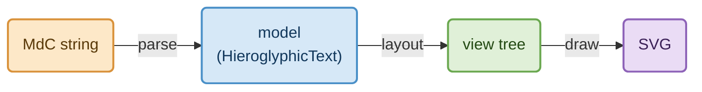

# JSeshJs user guide

This guide helps you use and integrate JSeshJs in your own project. It covers the everyday cases. Two other documents go further:

- the [customisation guide](customisation.md), if you need to change how JSeshJs draws, loads its data, or builds its editor and palette;
- the [maintainer guide](maintainer-guide.md), if you work on JSeshJs itself.

JSeshJs is the web version of [JSesh](https://jsesh.qenherkhopeshef.org): it displays (and lets you edit) hieroglyphic texts in your web pages, drawn exactly as JSesh draws them. It reads texts written in the *Manuel de Codage* (MdC).

## Before you start: the Manuel de Codage in one minute

You don't need to know much of MdC to follow this documentation. A text is a string where each hieroglyph is written with a **code**, and punctuation says how the signs are arranged:

| You write | You get | Meaning |
|---|---|---|
| `nfr` | the sign F35 | A sign can be written by its Gardiner code (`F35`) or by one of its phonetic values (`nfr`). |
| `i-w-r` | three signs in a row | `-` separates *quadrats* (the little squares in which signs are packed). |
| `p:t` | `p` above `t` | `:` stacks two signs vertically in one quadrat. |
| `f*t` | `f` next to `t` | `*` puts two signs side by side in one quadrat. |
| `a&b` | `a` and `b` as a ligature | `&` makes a ligature. |
| `%insert[dir=bs](D36,n:t)` | `n:t` tucked into the free space of `D36` | `%insert` fits a group inside the free space of a sign, whatever its shape. `dir` says where: `s`, `e` (start, end), `t`, `b` (top, bottom), `ts`, `bs`, `te`, `be` (corners) or `c` (center). `dw` and `dh` make room, in percent of the inserted group. |
| `G17-%hkern-G1`, `p:%vkern:q` | the groups moved closer | `%hkern` and `%vkern` kern the groups on each side, so that their signs are about one inter-sign space apart where they are closest. `%hkern` works between the elements of a horizontal group (`p*%hkern*q`) and between quadrats in lines; `%vkern` between the lines of a quadrat and between quadrats in columns. Elsewhere, they are ignored. |
| `!` | new line | |

So `i-w-r:a-C1-m-p*t:pt` is a whole phrase. The rest of the documentation simply passes such strings around: you give them to JSeshJs, and it draws them.

## What is in the box

JSeshJs is made of five small packages (plus an optional sixth, `@jsesh/vue`, see [Vue and React](#vue-and-react)):

| Package | What it does | Needs a browser? |
|---|---|---|
| `@jsesh/core` | Reads and writes MdC, holds the document model, computes the layout and draws it as SVG. | No: runs in browsers *and* in Node. |
| `@jsesh/glyphs` | The sign shapes, the font, and the sign database (families, values, tags...). | No (but it loads files, see below). |
| `@jsesh/elements` | The Web Component `<jsesh-text>` (display), and `autoRender()` for plain pages. | Yes. |
| `@jsesh/editor` | The hieroglyphic editor: `<jsesh-editor>`, and the pieces under it (`EditorSession`, `EditorView`...). | Yes (but `EditorSession` has no DOM). |
| `@jsesh/palette` | The sign palette: `<jsesh-palette>`, and the logic under it (`PaletteController`). | Yes (but `PaletteController` has no DOM). |

The editor and the palette come at **three levels**, so that you can take what suits you:

1. **A ready-made element**: `<jsesh-editor>` and `<jsesh-palette>`. Put them in a page, listen to their events. They work
   as they are in plain HTML, Vue, React or anything else which can use a Web Component.
2. **Logic without markup**: `PaletteController` (families, tags, search, variants, history...) and `EditorSession` (the
   editing state machine: text, cursor, selection, typing, undo...) hold *all* the behaviour and know nothing of the DOM.
   You show their `state` with your own markup (a Vue or React component, say), and call their methods. `EditorView`
   shows a session in an element of your choice, if you only want to build the surroundings yourself.
3. **Geometry**: `itemAreas`, `positionAt` and `caretArea` tell where each quadrat is in the picture, so that you can
   draw the cursor and the selection yourself.

And what exists today:

| | Status |
|---|---|
| Displaying MdC (`<jsesh-text>`, `autoRender()`, `renderMdc()`) | **Available** |
| Parsing and writing MdC, the document model, layout, sign database | **Available** |
| A hieroglyphic **editor** (cursor, selection, typing signs) | **Available**: `<jsesh-editor>`, `EditorSession`, `EditorView` |
| A sign **palette** | **Available**: `<jsesh-palette>`, `PaletteController` |

---

## Installation

### What do you need?

A web page showing hieroglyphs needs two things:

1. **The code**: small (about 130 kB for the whole library in one file).
2. **The glyph data**: big (38 MB in about 7,000 files), but a visitor's browser only downloads what it needs: an index of about 150 kB, the font, and the shapes of the signs which are actually displayed.

The data is kept separate from the code on purpose: it can live on another server, shared by several sites (see [Sharing the glyph data](#sharing-the-glyph-data-between-sites)).

### The two zip files

We start with one of the two zip files available:

- `jsesh-web-<NUMBER>.zip`: a full version of JSeshJs, including the font files;
- `jsesh-web-<NUMBER>-code-only.zip`: a version of JSeshJs without the font files. If you have multiple projects, it can allow you to save some space on your server by using `jsesh-web-<NUMBER>.zip` to provide the font files, and `jsesh-web-<NUMBER>-code-only.zip` for the other projects.

Both unzip into a `jsesh-web/` folder:

```text
jsesh-web/
├── index.html          the simplest possible page: view its source!
├── examples.css        styles for the examples only
├── README.md           a short guide for the recipient of the zip
├── jsesh/
│   ├── jsesh.js        the library, in ONE file
│   └── data/           the glyph data (full zip only)
├── editor/             a page with <jsesh-editor> and <jsesh-palette>
├── palette/            a page with <jsesh-palette>
└── custom/             an editor and a palette built from the lower-level parts
```

#### Testing it

- If you have put the files on a web server, opening the folder containing `index.html` in a browser should work;
- on your own computer, as browsers refuse to load data from the local file system, double-clicking `index.html` won't work. You need a small server. If you have python, you can use `cd jsesh-web && python3 -m http.server`, then open <http://localhost:8000/>. With php, `cd jsesh-web && php -S localhost:8000` works too, and in Node, `cd jsesh-web && npx serve` (install `serve` first with `npm install -g serve`).

### Configuring JSeshJs from scratch

In this part, we suppose you include your javascript code the old-fashioned way, with `<script>` tags. For modern framework, see the next section.

**Step 1: put the files on your site.** Copy the `jsesh/` folder (library and data) to your server, for instance so that it is available as `/jsesh/jsesh.js` and `/jsesh/data/`.

**Step 2: load the library and tell where the data is.** `jsesh.js` is a JavaScript *module*, hence you need to add`type="module"` to your `<script>` tag:

```html
<script type="module">
  import { configureJSesh } from "/jsesh/jsesh.js"; // also defines <jsesh-text>
  configureJSesh({ glyphsUrl: "/jsesh/data/" });     // once, before the first text is displayed
</script>
```

**Step 3: write hieroglyphs.**

```html
<p>The word <jsesh-text>nfr-f:r</jsesh-text> means "good".</p>
```

That is all. A complete page:

```html
<!doctype html>
<html lang="en">
  <head><meta charset="utf-8" /><title>My first hieroglyphs</title></head>
  <body>
    <p>The word <jsesh-text>nfr-f:r</jsesh-text> means "good".</p>

    <script type="module">
      import { configureJSesh } from "/jsesh/jsesh.js";
      configureJSesh({ glyphsUrl: "/jsesh/data/" });
    </script>
  </body>
</html>
```

A few remarks:

- **Modules and "classic" scripts.** A plain `<script>` (without `type="module"`) cannot use `import`. If you must stay with classic scripts, load the library with a dynamic import: `const jsesh = await import("/jsesh/jsesh.js")` (inside an `async` function, or in a module).
- **Relative URLs** work too (`"./jsesh/data/"`), relative to the page.
- **Bare names.** Examples elsewhere in this documentation write `from "@jsesh/elements"`. A browser cannot resolve such a *bare name* by itself: it only understands URLs. In a page without a bundler, replace it with `"/jsesh/jsesh.js"` (which exports everything from the five packages), or declare an [import map](https://developer.mozilla.org/en-US/docs/Web/HTML/Element/script/type/importmap) before your scripts, as the `editor/` page of the zip does:

  ```html
  <script type="importmap">
    { "imports": {
        "@jsesh/core": "/jsesh/jsesh.js",
        "@jsesh/glyphs": "/jsesh/jsesh.js",
        "@jsesh/elements": "/jsesh/jsesh.js",
        "@jsesh/editor": "/jsesh/jsesh.js",
        "@jsesh/palette": "/jsesh/jsesh.js"
    } }
  </script>
  ```

## Using JSeshJs to render hieroglyphic text

### The `<jsesh-text>` element

Once you have set up JSeshJs, for your page with the javascript `<script>` from **step 3** above, you can write hieroglyphs in your page with `<jsesh-text>`:

```html
<p>The word <jsesh-text>nfr-f:r</jsesh-text> means "good".</p>
<jsesh-text cadrat-height="40" direction="rtl">i-w-r:a-C1-m-p*t:pt</jsesh-text>
```

The element is `inline-block`, so it sits in a line of text like a word, and can also be styled like any other element. Its text comes from its `mdc` attribute (or property) or, if there is none, from its content. If you change either one, the picture is redrawn.

The text can even be a whole JSesh document (the content of a `.gly` file): the preferences stored in its header (direction, justification...) are then used.

#### Attributes

| Attribute | Meaning |
|---|---|
| `mdc` | The text. Overrides the element's content. |
| `cadrat-height` | Height of a quadrat, in pixels. By default, 1.5 times the font size of the surrounding text, so hieroglyphs scale with your text. |
| `direction` | `ltr` or `rtl`. |
| `orientation` | `horizontal` or `vertical` (columns). |
| `centered` | (no value) center small signs in their quadrat. |
| `justified` | (no value) justify lines. |
| `glyphs-url` | Glyph data for this text only (see [Sharing the glyph data](#sharing-the-glyph-data-between-sites)). |

#### Changing the style: `jseshStyle`

For everything else (colours, line widths, fonts...), set the `jseshStyle` property to an object containing only the values you want to change. It has four optional parts: `geometry`, `painting`, `fonts`, `options` (see `JSeshStyle` in `@jsesh/core`):

```js
const el = document.querySelector("jsesh-text");
el.jseshStyle = { painting: { blackColor: "#223366", redColor: "#aa0000" } };
```

To change the style of **all** the texts of the page, pass `style` to `configureJSesh`:

```js
configureJSesh({ glyphsUrl: "/jsesh/data/", style: { painting: { blackColor: "#223366" } } });
```

#### Events

| Event | When |
|---|---|
| `jsesh-render` | The text has been drawn. |
| `jsesh-error` | It could not be drawn (invalid MdC, data not found...). The error is in `event.detail`. |

On error, the element does not throw: it shows its own content as plain text instead. This is what makes live previews possible (see [Editing](#using-jseshjs-to-edit-hieroglyphic-text)).
You can use an *event listener* to catch the events if you want. You will find examples below.

### Without custom elements: `autoRender()`

`<jsesh-text>` is not standard html, and it can confuse some softwares. If you don't want to use it, Manuel de codage text can be put in standard `html` elements.
You can use `autoRender()` to turn any element into a hieroglyphic text. It looks for elements of **class** `mdc` and replaces their content with the picture:

```html
<span class="mdc">i-w-r:a-C1-m-p*t:pt</span>
<script type="module">
  import { autoRender } from "/jsesh/jsesh.js";
  autoRender({ observe: true }); // observe: also process elements added later
</script>
```

Options: `className` (another class: `autoRender({ className: "hiero" })`), `selector` (any CSS selector) and `observe`.

### Getting an SVG string: `renderMdc()`

For full control, `renderMdc` produces a string representation of the text as a `<svg>` element:

```js
import { renderMdc } from "/jsesh/jsesh.js";

const svg = await renderMdc("nfr-f:r", { cadratHeight: 40 });
document.getElementById("target").innerHTML = svg;
```

`renderMdc` takes the same `style` and `glyphsUrl` options as the element. It is `async` because it may have to load sign shapes.

### On a server, or in a script

The same rendering works in Node, with no browser: use `@jsesh/core` and `@jsesh/glyphs`, and read the data from the disk.

```ts
import { readFileSync } from "node:fs";
import { ApproximateTextMeasurer, renderToSvg } from "@jsesh/core";
import { GlyphIndexProvider } from "@jsesh/glyphs";

const data = "node_modules/@jsesh/glyphs/data";
const glyphs = new GlyphIndexProvider(JSON.parse(readFileSync(`${data}/glyph-index.json`, "utf-8")), async (file) =>
  JSON.parse(readFileSync(`${data}/glyphs/${file}.json`, "utf-8")),
);
const svg = await renderToSvg("i-w-r:a-C1-m-p*t:pt", { glyphs, measurer: new ApproximateTextMeasurer(), cadratHeight: 30 });
```

Without a canvas, Latin (alphabetic) text is measured approximately; hieroglyphs are not affected.

(`jsesh.js`, the one-file bundle, is meant for browsers, since it defines a custom element. In Node, use the packages.)

### How it works (a mental model)

It helps to know the three steps behind every picture:



1. **Parse**: the string becomes a *model*, a tree of quadrats and signs (see [Manipulating Manuel de Codage](#manipulating-manuel-de-codage-with-jseshjs)).
2. **Layout**: JSesh's algorithm decides where each sign goes, using the sizes found in `glyph-index.json`. The result is a tree of *views*, with positions, in points.
3. **Draw**: the views are turned into SVG, loading the shape of each sign.

`<jsesh-text>` and `renderMdc` do the three steps for you. If you need a step on its own, the functions are `parseMdc`, `layOutInPage` / `layOutText`, and `drawLaidOutText`.

---

## Using JSeshJs to edit hieroglyphic text

"Editing" can mean two quite different things. Pick the one you need.

### Option 1: an ordinary text field with a live preview

The user types MdC as plain text (`nfr-f:r`), and the field's value *is* the MdC. This is the simplest solution, and perfectly enough for a search box or a comment form. Since `<jsesh-text>` does not throw on invalid text (a partial one, while typing), it can be updated at each keystroke:

```html
<input id="query" size="40" placeholder="MdC, for instance nfr-f:r" />
<jsesh-text id="preview" cadrat-height="40"></jsesh-text>

<script type="module">
  import { configureJSesh } from "/jsesh/jsesh.js";
  configureJSesh({ glyphsUrl: "/jsesh/data/" });

  const query = document.getElementById("query");
  const preview = document.getElementById("preview");
  preview.addEventListener("jsesh-error", () => preview.classList.add("invalid"));
  preview.addEventListener("jsesh-render", () => preview.classList.remove("invalid"));
  query.addEventListener("input", () => (preview.mdc = query.value)); // query.value is the MdC to use
</script>
```

Add a `.invalid` rule in your CSS (a red outline, say) to tell the user that the text is not valid yet.

### Option 2: a real hieroglyphic editor

Here the user clicks in a box showing the hieroglyphs, with a blinking cursor, and types sign codes; there are selection, undo and redo. This is `<jsesh-editor>`, from `@jsesh/editor` (included in `jsesh.js` in the zip).

A complete page, in its minimal form:

```html
<!doctype html>
<html>
  <body>
    <jsesh-editor id="editor" cadrat-height="45">nfr-f:r-!nfr-f:r</jsesh-editor>
    <button id="linebreak" title="New line (!)">New line</button>

    <script type="module">
      import { configureJSesh } from "./jsesh/jsesh.js"; // also defines <jsesh-text>, <jsesh-editor>, <jsesh-palette>
      configureJSesh({ glyphsUrl: "./jsesh/data/" });

      const editor = document.getElementById("editor");
      editor.addEventListener("jsesh-change", (e) => console.log(e.detail.mdc)); // after each change

      // Insert a line break (-!) at the caret, then give the focus back to the editor.
      document.getElementById("linebreak").addEventListener("click", () => {
        editor.insertMdc("!");
        editor.focus();
      });
    </script>
  </body>
</html>
```

Click in the box to give it the keyboard (or call `editor.focus()`). The initial text is the element's content or its `mdc` attribute.

#### Typing, as in JSesh

The editor types like JSesh does: you type a **code**, then a **separator** which says how it connects to the next sign.

| Key | Effect |
|---|---|
| a code, then <kbd>-</kbd>, <kbd>Space</kbd> or <kbd>Enter</kbd> | The sign goes into a new quadrat. |
| a code, then <kbd>:</kbd>, <kbd>*</kbd> or <kbd>&</kbd> | The sign is grouped with the next one (stacked, side by side, ligature). So <kbd>p</kbd> <kbd>:</kbd> <kbd>t</kbd> <kbd>Space</kbd> gives `p` above `t`. |
| <kbd>!</kbd> | New line. |
| <kbd>Backspace</kbd>, <kbd>Delete</kbd> | Erase. |
| <kbd>Esc</kbd> | Forget the code being typed. |
| arrows, <kbd>Home</kbd>, <kbd>End</kbd> | Move the cursor; with <kbd>Shift</kbd> (or shift-click), select. |
| <kbd>Ctrl</kbd>/<kbd>⌘</kbd>+<kbd>Z</kbd> | Undo; with <kbd>Shift</kbd>, redo. <kbd>Ctrl</kbd>/<kbd>⌘</kbd>+<kbd>A</kbd>: select all. |

#### `<jsesh-editor>` reference

**Attributes:** `mdc` (initial text; overrides the content), `cadrat-height` (height of a quadrat in pixels, 45 by default), `direction` (`ltr` or `rtl`), `orientation` (`horizontal` or `vertical`), `glyphs-url`, `show-kerning-marks` (shows `%hkern` and `%vkern` as marks, as a word processor shows paragraph marks; also the `showKerningMarks` property). The `jseshStyle` property takes any style change, as for `<jsesh-text>`.

**Properties and methods:**

| Member | Role |
|---|---|
| `mdc` | The text. Read it to get the MdC; set it to replace the text (setting what is already there does nothing, so it can be bound to a model: see [Vue and React](#vue-and-react)). |
| `state` | `{ mdc, code, separator, caret, length, selection, selectionStart, selectionEnd, error, canUndo, canRedo }`: what to show around the editor. |
| `insertSign(code)` | Insert a sign at the cursor, as if typed. |
| `insertMdc(mdc)` | Insert MdC text at the cursor (replacing the selection). |
| `group(separator)`, `cartouche()`, `toggleRed()` | Operate on the selection (or on what is before the cursor). |
| `undo()`, `redo()` | |
| `document()` | The text as a JSesh document (the content of a `.gly` file, with header). |
| `cadratHeight` | Height of a quadrat, in pixels. |
| `focus()` | Give the keyboard to the editor. |
| `session` | The `EditorSession` behind the element (see below), for everything the element does not forward: `session.setOptions(...)`, `session.moveCaret(...)`... |

**Events:** `jsesh-change` after each change of the text, the cursor or the code being typed (`event.detail` is the `state`); `jsesh-error` if the text can't be drawn (the glyph data can't be loaded...).

**Appearance.** The editor lives in a shadow DOM, so your page's CSS does not leak into it. Use custom properties: `--jsesh-caret-color`, `--jsesh-selection-color`, `--jsesh-inactive-caret-color` (caret when the editor has no focus), `--jsesh-editor-border`, `--jsesh-editor-background`, `--jsesh-editor-min-height`; and `jsesh-editor::part(surface)` for anything else:

```css
jsesh-editor { --jsesh-editor-min-height: 10rem; --jsesh-selection-color: rgb(255 200 0 / 30%); }
jsesh-editor::part(surface) { border-radius: 12px; }
```

#### Going further

`<jsesh-editor>` is built from an `EditorSession` (the editing state machine, with no DOM) and an `EditorView` (which shows it). If you want your own markup, your own toolbar, or an editor inside a Vue or React component, see the [customisation guide](customisation.md#building-your-own-editor).

---

## Using the Hieroglyphic Palette to Select and Navigate Signs

### Why a palette?

With about 7,000 signs, nobody knows every code by heart. A user who wants a sign usually knows *something* about it, but not always its code:

- its **pronunciation** (`nfr`, `m`);
- its **family** (birds, gods, buildings...);
- its **shape**: "it looks like A1, but with something added";
- or only that it is **a variant** of another sign.

A plain text field handles only the first case (and only if you already know the value). Egyptologists typing hieroglyphs on the web have often had to leave the page to look signs up in a book or another program. JSesh's own **palette** solves this inside the application, and JSeshJs offers the same tool for the web: you look at the signs, narrow down, and pick.

### What the user can do

The palette shows a grid of signs, each drawn with the JSesh font, and a panel describing the selected sign.

#### Finding signs

| Control | What it does |
|---|---|
| **Family** list | The standard Gardiner families (`A. Man and his occupations`, `G. Birds`... as in Gardiner's list), plus *Latest signs* (those you chose recently), *User palette* (those you put in "my palette"), *All signs*, and three shape-based lists: *Tall narrow*, *Low broad* and *Low narrow* signs. |
| **Show all variants** | By default, a family shows its main signs; tick this box to also see the variants. |
| **Tag** and **secondary tag** lists | Narrow a family down. Signs carry tags describing them (A1, for instance, is tagged `seated` and `holding nothing`); the first list shows the tags of the family, the second the other tags of the signs which remain. |
| **Search** box | Type a *value* (`nfr`, `m`) or a *code* (`A1`, `G17`, or the start of a code) and press Enter. |
| **Containing…** list | Among the signs displayed, keep those which contain a given sign as a part. |

#### Navigating from one sign to another

This is what makes the palette more than a list: it follows the *relations* between signs.

- Click a sign: the panel shows its **values**, **tags**, **description**, its **variants** and the signs it **contains**. Each variant and each part is itself a small button: click it to jump there.
- **Variants** button: shows the variants of the selected sign. Click again: the variants *of those variants*, and so on. (This is how you find a sign which is only "similar" to the one you know.)
- **Containing** button: shows the signs which contain the selected sign (ligatures, composed signs...). Click again to go one level further.
- **Back** button: returns to the previous sign (the last 6 are remembered).
- **In my palette** box: puts the sign in the user palette, for signs you use all the time.

#### Choosing

Double-click a sign, press Enter (or Space) on it, or click **Choose**. The palette then sends a `sign-chosen` event; the code of the sign is in `event.detail`. The sign also goes into *Latest signs*.

**Keyboard.** The grid can be used without a mouse: Tab enters the grid, the arrows move from sign to sign, Enter chooses.

### Using it in a page

The palette is the `<jsesh-palette>` element of `@jsesh/palette` (included in `jsesh.js` in the zip):

```html
<jsesh-palette id="palette"></jsesh-palette>

<script type="module">
  import { configureJSesh } from "/jsesh/jsesh.js"; // also defines <jsesh-palette>
  configureJSesh({ glyphsUrl: "/jsesh/data/" });

  document.getElementById("palette").addEventListener("sign-chosen", (e) => {
    console.log("The user chose", e.detail); // for instance "A1"
  });
</script>
```

That is the whole interface: *put the element in the page; listen to `sign-chosen`*. The palette needs the sign database (`sign-info.json`, see [The sign database](#the-sign-database)), which it loads by itself from the same place as the shapes (`glyphsUrl`, or its own `glyphs-url` attribute). What you do with the code is up to your page.

| Member | Role |
|---|---|
| `sign-chosen` event | A sign was chosen; `event.detail` is its code. It bubbles, and crosses the shadow DOM. |
| `jsesh-error` event | The sign database could not be loaded. |
| `glyphs-url` attribute | Where the data is, for this palette only. |
| `database` property | A `SignDatabase` you already have (from `loadSignDatabase`), instead of loading one. |
| `labels` property | The texts of the palette, to translate them (see below). |
| `storage` property | Where the latest signs and the user palette are kept (see below). |
| `controller` property | The `PaletteController` behind the element, once the database is loaded. |
| `choose(code?)` | Choose a sign (the selected one by default), as the *Choose* button does. |

### Connecting the palette to an editor, or to a text field

**With `<jsesh-editor>`**, a chosen sign is inserted at the cursor, exactly as if the user had typed its code followed by a space:

```js
palette.addEventListener("sign-chosen", (e) => {
  editor.insertSign(e.detail);
  editor.focus(); // give the keyboard back to the editor, so that typing goes on
});
```

Because `insertSign` follows JSesh's typing rules, this combines well with the keyboard. If the user types `p` then `:`, and *then* picks `t` in the palette, the two signs are stacked: the palette obeys the separator which was typed last. The page `editor/index.html` in the zip shows the palette in a side panel which can be hidden.

**With a text field** (the first editing option above), append the code to the field and refresh the preview:

```js
palette.addEventListener("sign-chosen", (e) => {
  query.value += (query.value === "" ? "" : "-") + e.detail; // "-": a new quadrat
  query.dispatchEvent(new Event("input"));                    // redraw the preview
});
```

`palette/index.html` is a minimal page of the same kind: chosen signs are joined with `-` and shown with `<jsesh-text>`.

### What it costs, and how it stays fast

Showing "All signs" means thousands of cells, but the palette only draws what is on screen: a sign is rendered (with `renderMdc`) when its cell scrolls into view, using an `IntersectionObserver`. Shapes are fetched by the usual rule, only when needed, so the palette downloads little more than `sign-info.json` (130 kB compressed) and the shapes visitors actually look at.

### Remembering the user's choices

The *Latest signs* and *User palette* lists are kept in the browser's `localStorage` (keys `jsesh-palette-last` and `jsesh-palette-user`). They belong to one browser on one site: they are not shared between devices. If you want them saved in your own database, give the palette a `storage` (an object with `load(key)`, which returns an array of codes, and `save(key, codes)`), or listen to `sign-chosen` and keep your own list. If `localStorage` is not available (private mode...), the palette still works but forgets.

```js
palette.storage = {
  load: (key) => JSON.parse(myDatabase.get(key) ?? "[]"),
  save: (key, codes) => myDatabase.set(key, JSON.stringify(codes)),
};
```

`memoryPaletteStorage()` is a storage which keeps nothing outside the page.

### Customizing

- **Appearance.** The palette lives in a shadow DOM, so your CSS does not leak into it. Use custom properties (`--jsesh-palette-border`, `--jsesh-palette-background`, `--jsesh-palette-muted-background`, `--jsesh-palette-selected-background`, `--jsesh-palette-selected-border`, `--jsesh-palette-grid-height`, `--jsesh-palette-info-width`), and `::part(...)` for the rest. Every control and zone has a part (`family`, `show-all`, `tag`, `secondary-tag`, `search`, `contains`, `count`, `signs`, `sign`, `selected`, `info`, `picture`, `code`, `choose`, `variants`, `containing`, `back`, `in-user-palette`, `values`, `tags`, `variant-list`, `parts`, `description`, `code-link`), which also lets you hide a control:

  ```css
  jsesh-palette::part(tag), jsesh-palette::part(secondary-tag) { display: none; }
  jsesh-palette { --jsesh-palette-grid-height: 18rem; }
  ```

  The palette adapts to the width of its container: in a narrow one (a side panel), the information goes under the signs.
- **Texts.** `palette.labels = { choose: "Choisir", showAllVariants: "montrer les variantes", ... }` (see `PaletteLabels` and `DEFAULT_PALETTE_LABELS`: the texts you don't give stay in English). Set it before the palette is displayed, or it is built again.
- **Behaviour, or a completely different look**: use `PaletteController`, below.

### Going further: a palette with your own look

`<jsesh-palette>` is a thin layer over `PaletteController`, which holds all the behaviour and knows nothing about the DOM. To draw the palette your own way, see the [customisation guide](customisation.md#building-your-own-palette).

### Where the knowledge comes from

The families, values, tags, variants and descriptions are those of JSesh's own sign database, exported from the Java application, so the web palette and the desktop one agree. Everything is read-only here: the palette does not edit the database (JSesh's separate *sign information editor* does that).

---

## Manipulating Manuel de Codage with JSeshJs

Everything in this section is in `@jsesh/core`, so it can run both in a browser and in Node.

### Reading and writing

```js
import { parseMdc, toMdc } from "@jsesh/core";

const text = parseMdc("nfr-f:r");   // a HieroglyphicText
toMdc(text);                         // "nfr-f:r" again
```

`parseMdc` returns the **model**; `toMdc` writes a model back as MdC, in JSesh's own dialect (so the output may be spelled slightly differently from the input, but means the same).

### Invalid text

`parseMdc` throws a `MdcSyntaxError` when the text is not valid. The error tells you where:

```js
import { MdcSyntaxError, parseMdc } from "@jsesh/core";

try {
  parseMdc("nfr-(");
} catch (e) {
  if (e instanceof MdcSyntaxError) console.log(e.message, e.line, e.charPos, e.token); // line is 0-based
}
```

### Whole documents (`.gly` files)

A JSesh file is MdC text preceded by an optional header holding the preferences (direction, orientation, fonts...). Two functions handle both parts at once:

```js
import { readMdcDocument, writeMdcDocument } from "@jsesh/core";

const doc = readMdcDocument(fileContent); // { preferences, text }
doc.preferences;                          // what the header said (or the defaults)
writeMdcDocument(doc);                    // header + MdC, ready to be saved as a .gly file
```

By default, `readMdcDocument` is *forgiving*, like JSesh: lines which cannot be read are replaced by an error message followed by the source line. Use `{ failFast: true }` to get the exception instead.

### The document model

The model is a tree. You walk it with `children` (and `parent`):

```
HieroglyphicText                ← the whole text
 └─ top items:  Cadrat (a quadrat), LineBreak, PageBreak, Cartouche...
      └─ Cadrat → HBox(es) → Hieroglyph (one sign), Ligature, ...
```

The most useful pieces:

| | |
|---|---|
| `HieroglyphicText` | `topItems`, `getTopItemAt(i)`, `addTopItem()`, `insertItemsAt()`, `removeItems(start, end)`, `deepCopy()`, `getCodes()`. |
| `Hieroglyph` | `code` (as written: `"nfr"`, `"A1"`...) and its modifiers. |
| any element | `children`, `numberOfChildren`, `parent`, `accept(visitor)`, `deepCopy()`. |

For instance, to list the sign codes of a text:

```js
import { parseMdc } from "@jsesh/core";

parseMdc("i-w-r:a-C1-m-p*t:pt").getCodes(); // the codes, in order of first appearance
```

or to walk the whole tree yourself (as the search example below does): `if (element instanceof Hieroglyph) ... else element.children.forEach(visit)`.

The model is **observable**: `text.addObserver((operation) => ...)` is told of each insertion, deletion or modification. This is what lets an editor redraw only what is needed.

### Normalizing: one spelling for one sign

The same sign has several names: the Gardiner code `F35`, the phonetic value `nfr`. `toMdc` can replace each by a canonical form, using the sign database:

```js
import { loadGlyphProvider } from "@jsesh/glyphs";

const glyphs = await loadGlyphProvider("/jsesh-glyphs/");
toMdc(parseMdc("nfr-f:r"), { normalize: (code) => glyphs.canonicalCode(code) });
```

The result is one canonical string per text: ideal to index in a database, or to compare with `===` or `includes`. `canonicalCode` only needs `glyph-index.json`, not the shapes, so it also works cheaply in Node.

Another option of `toMdc` is to write a part of the text only: `toMdc(text, { start: 2, end: 5 })` writes the top items 2 to 4.

### Example: finding a typed text

JSesh's search (`jseshSearch`) is not ported. Still, MdC is easy to compare once it is *normalized*: `a`, `nfr` or `F35` all denote the same sign, and the same sign can be spelled in several ways in the texts. The idea: parse the query and the texts, reduce them to the lists of their canonical sign codes, and look for the former in the latter.

```js
import { Hieroglyph, parseMdc } from "@jsesh/core";
import { loadGlyphProvider } from "@jsesh/glyphs";

const glyphs = await loadGlyphProvider("/jsesh-glyphs/"); // same URL as for configureJSesh

/// The canonical (Gardiner) codes of the signs in an MdC text, in reading order.
function signs(mdc) {
  const result = [];
  const visit = (element) => {
    if (element instanceof Hieroglyph) result.push(glyphs.canonicalCode(element.code));
    else element.children.forEach(visit);
  };
  visit(parseMdc(mdc)); // throws if the MdC is invalid
  return result;
}

/// Is `needle` a run of consecutive signs of `haystack`?
function contains(haystack, needle) {
  if (needle.length === 0) return false;
  for (let i = 0; i + needle.length <= haystack.length; i++) {
    if (needle.every((code, j) => haystack[i + j] === code)) return true;
  }
  return false;
}

const corpus = [{ id: 1, mdc: "i-w-r:a-C1-m-p*t:pt" }, { id: 2, mdc: "nfr-f:r-A1" }];
const entries = corpus.map(({ id, mdc }) => ({ id, mdc, signs: signs(mdc) })); // do it once

query.addEventListener("input", () => {
  try {
    const wanted = signs(query.value);
    const found = entries.filter((entry) => contains(entry.signs, wanted));
    // show `found`, each entry with <jsesh-text>
  } catch {
    // the query is not valid MdC (yet)
  }
});
```

Typing `nfr` finds entry 2 (`nfr` is `F35`). Grouping (`:`, `*`) is ignored: this searches for signs in sequence, wherever they are in the quadrats. If quadrats should matter, compare the normalized MdC instead (see *Normalizing*, above).

### The sign database

Palettes and sign searches need more than shapes: families, phonetic values, tags, variants. `sign-info.json` holds all this, and `loadSignDatabase(url)` reads it as a `SignDatabase`, whose methods are those of JSesh's `HieroglyphDatabase`:

```js
import { loadSignDatabase } from "@jsesh/glyphs";

const db = await loadSignDatabase("/jsesh-glyphs/"); // the data folder, as for configureJSesh
db.getFamilies();
db.getValuesFor("F35");           // phonetic values
db.getTagsForSign("F35");
db.getVariants("F35");
db.getSignsContaining("F35");
db.getDescriptionFor("F35");
db.getPossibilityFor("nfr");      // signs which can be written with this value
```

`PaletteController` (in `@jsesh/palette`) is a complete use of this database.

### Going further: the model and the syntax tree

You can also edit the model directly and display the result without going back through MdC, or work on the literal syntax tree (`parseMdcAst`). Both are described in the [customisation guide](customisation.md#working-with-the-model).

## The glyph data

`@jsesh/glyphs` reads a folder containing:

| File | Size | Role |
|---|---|---|
| `glyph-index.json` | 540 kB (150 kB compressed) | The size and ligature zones of each of the ~7,000 signs, the phonetic codes and the predefined ligatures. Loaded once: with it alone, texts can be laid out. |
| `glyphs/*.json` | one file per sign | The shape of a sign, loaded only when it is displayed. |
| `fonts/CharisSIL-R.woff` | | The transliteration font (Charis SIL). |
| `sign-info.json` | 700 kB (130 kB compressed) | The sign database, for palettes and searches only. |

You can serve it yourself, share it between sites (`glyphsUrl`), or use the copy inside the package. To use another source of signs, implement `GlyphProvider` (in `@jsesh/core`): see the [customisation guide](customisation.md#using-your-own-signs-or-your-own-data-source).


## Advanced points

### Sharing the glyph data between sites

Note that the simplest way to use JSeshJs is to use the full zip, which contains the font files. It requires less setup and fewer headaches. However, the fonts are large, and if you run several sites, you may want to host the font files once and point all your sites to the same data.

`glyphsUrl` can be an absolute URL. If you run several sites, host `jsesh/data/` once (on any static server or CDN), install the **code-only** zip on each site, and point them all to the same data:

```js
configureJSesh({ glyphsUrl: "https://static.example.org/jsesh-glyphs/0.1.0/" });
```

The server hosting the data must be set up properly:

- **CORS.** The data is read with `fetch` and the font is loaded as a web font, and browsers apply CORS to both. The host must answer with `Access-Control-Allow-Origin: *` (or the list of your sites). Without it, nothing is displayed; the browser console shows the blocked request. *This is the most common problem.*
- **Content types and compression**: `.json` as `application/json`, `.woff` as `font/woff`; the JSON files should be served with gzip or brotli (the `.woff` font is already compressed).
- **Caching**: put the data in a versioned folder (`.../0.1.0/`) with a long `Cache-Control`, so that returning visitors download nothing.

A single `<jsesh-text>` can also read its own data with its `glyphs-url` attribute.

#### Example: an `.htaccess` file for Apache

If the data is hosted on an Apache server (the most common case on shared hosting), the three requirements above can be met with a single small file, called `.htaccess`.

**Where does it go?** In the folder which holds the data, that is the one containing `glyph-index.json`, `sign-info.json`, `fonts/` and `glyphs/`. A `.htaccess` file applies to its own folder and to all the folders below it, so one file at the top covers every file of the data. For the example URL above, with the data served from `https://static.example.org/jsesh-glyphs/0.1.0/`:

```text
(web root of static.example.org)
└── jsesh-glyphs/
    └── 0.1.0/
        ├── .htaccess          ← here
        ├── glyph-index.json
        ├── sign-info.json
        ├── fonts/
        └── glyphs/
```

Note the leading dot in the name: `.htaccess` is a "hidden" file, which some FTP clients and file managers do not show by default, and which `unzip` or a drag-and-drop may leave behind. Check that it was really uploaded.

**What does it contain?**

```apache
# --- 1. CORS: let pages of other sites read these files -----------------------
# REQUIRED if pages on another site use these files; useless if same site.
<IfModule mod_headers.c>
  Header set Access-Control-Allow-Origin "*"
</IfModule>

# --- 2. Content types ----------------------------------------------------------
# Optional safety net: Apache usually knows these types already.
<IfModule mod_mime.c>
  AddType application/json .json
  AddType font/woff .woff
</IfModule>

# --- 3. Compression (the JSON files are text: they shrink a lot) --------------
# Optional, for performance only.
<IfModule mod_deflate.c>
  AddOutputFilterByType DEFLATE application/json
</IfModule>

# --- 4. Caching: the folder is versioned, so its files never change -----------
# Optional, for performance only. Remove if you overwrite files under the same URL.
<IfModule mod_headers.c>
  Header set Cache-Control "public, max-age=31536000, immutable"
</IfModule>
```

Block by block:

1. **CORS.** `Access-Control-Allow-Origin: *` tells browsers that a page from *any* site may read these files. The data is public and read-only, so this is harmless. If you prefer to name your sites, replace the first block with:

   ```apache
   <IfModule mod_headers.c>
     SetEnvIf Origin "^https://(www\.)?(site-one\.org|site-two\.org)$" ALLOWED_ORIGIN=$0
     Header set Access-Control-Allow-Origin "%{ALLOWED_ORIGIN}e" env=ALLOWED_ORIGIN
     Header append Vary Origin
   </IfModule>
   ```

   (`Vary: Origin` stops caches from giving one site's answer to another.)
2. **Content types.** Many servers already know `.json`, but older ones do not know `.woff`. Declaring both is harmless.
3. **Compression.** The JSON files are large text files, which compress well: `glyph-index.json` goes from 540 kB to about 150 kB. Do not compress the `.woff` font, it already is. If your server has `mod_brotli`, you can use it instead (same line, with `BROTLI` in place of `DEFLATE`).
4. **Caching.** Visitors keep the files for a year and do not even ask the server again. This is safe *only if you change the folder name for each version* (`0.1.0/`, then `0.2.0/`...), because browsers will never look at a file they consider fresh. Never overwrite the data of a published version.

The `<IfModule ...>` wrappers make the file harmless when a module is missing: the corresponding block is simply ignored instead of causing an error. The flip side is that a missing module fails *silently*, so test (below).

**It does not seem to work?**

- *Test it from a terminal*, simulating a page of another site:

  ```bash
  curl -sI -H "Origin: https://example.com" -H "Accept-Encoding: gzip" \
    https://static.example.org/jsesh-glyphs/0.1.0/glyph-index.json
  ```

  In the answer you want `Access-Control-Allow-Origin: *`, `Content-Type: application/json`, `Content-Encoding: gzip` and the `Cache-Control` line. Whichever is missing tells you which block does not apply.
- *"500 Internal Server Error" on every file*: the server refuses a directive of the file. With a main configuration which does not allow `.htaccess` to set headers, types or expiry, Apache answers 500. Ask your host to enable `AllowOverride FileInfo` for this folder, or, if you manage the server, put the same directives in the virtual host: inside a `<Directory "/path/to/jsesh-glyphs">` block, in which case no `.htaccess` is needed.
- *Headers missing, but no error*: `mod_headers` (CORS and caching), `mod_deflate` (compression) may not be enabled on the server (`a2enmod headers deflate` on Debian/Ubuntu, then reload Apache).
- *A CDN or proxy in front of the server* may add or strip headers: test the public URL, not the origin server.
- *Nginx or another server*: the same four things are needed (CORS header, content types, compression, caching header), but in that server's own configuration language; `.htaccess` is an Apache feature only.


### Configuring JSeshJs in a modern framework

We will suppose you use `npm` and `vite` here. The same ideas apply to other bundlers.

> The packages are **not published on npm yet**. Until then, you install them from tarballs built from the sources.

**Step 1: build the tarballs.** In the `jsesh-js` folder of the JSesh sources:

```bash
npm install && npm run build
for p in core glyphs elements editor palette; do (cd packages/$p && npm pack --pack-destination /somewhere); done
```

You get `jsesh-core-0.1.0.tgz`, `jsesh-glyphs-0.1.0.tgz` (10 MB: it contains the glyph data), `jsesh-elements-0.1.0.tgz`, `jsesh-editor-0.1.0.tgz` and `jsesh-palette-0.1.0.tgz`. (Only the first three are needed to display texts.)

**Step 2: install them in your project**, all in the same command (they depend on each other):

```bash
npm install /somewhere/jsesh-core-0.1.0.tgz /somewhere/jsesh-glyphs-0.1.0.tgz /somewhere/jsesh-elements-0.1.0.tgz \
  /somewhere/jsesh-editor-0.1.0.tgz /somewhere/jsesh-palette-0.1.0.tgz
```

**Step 3: make the glyph data available.** The data is not JavaScript, so it should not go through the bundler: it must be *served as files*. With Vite, copy it into the `public/` folder, which is served as is:

```bash
cp -r node_modules/@jsesh/glyphs/data public/jsesh-glyphs
```

(Or host it elsewhere, as in the previous section.) Add this copy to your build scripts if you want it to follow upgrades of the package. Remember that `public/` is copied into your final `dist/`: 38 MB of data.

**Step 4: configure and use.** In your entry file (`src/main.js`):

```js
import { configureJSesh } from "@jsesh/elements"; // also defines <jsesh-text>
import "@jsesh/editor";  // <jsesh-editor>, if you need it
import "@jsesh/palette"; // <jsesh-palette>, if you need it

// Always set glyphsUrl with a bundler: the default location is the `data` folder next to the
// package's own files, which doesn't exist once the code is bundled.
configureJSesh({ glyphsUrl: "/jsesh-glyphs/" });
```

and in your HTML, `<jsesh-text>nfr-f:r</jsesh-text>` works.

*Alternative, without tarballs:* take `jsesh.js` from the zip, put it in your sources (say `src/vendor/jsesh.js`), and `import { configureJSesh } from "./vendor/jsesh.js"`. It is the same code, in one file.

### Vue and React

The recipes below are adapted from code which was run with Vue 3.5 and React 19. In both, do the imports and the `configureJSesh` call once, in your entry file:

```js
import { configureJSesh } from "@jsesh/elements"; // defines <jsesh-text>
import "@jsesh/editor";                            // defines <jsesh-editor>
import "@jsesh/palette";                           // defines <jsesh-palette>

configureJSesh({ glyphsUrl: "/jsesh-glyphs/" });
```

For Vue, the `@jsesh/vue` package (folder `jsesh-vuejs/`) already wraps the elements as components (`<JSeshText>`, `<JSeshEditor>`, `<JSeshEditorToolbar>`, `<JSeshPalette>`, with `v-model:mdc`), and has a sample application: see [its README](../jsesh-vuejs/README.md). What follows explains how it is done with the elements, and what to do in other frameworks.

There are two ways to use the editor and the palette in a framework: use the **elements** as they are (the simple way, and enough for most uses, described here), or build your own components on the **headless parts** (`EditorSession`, `PaletteController`) when you want to control the markup (see the [customisation guide](customisation.md)).

#### With the elements

**Vue.** Tell the template compiler that `jsesh-*` tags are not Vue components (otherwise it warns about an unknown component): `compilerOptions.isCustomElement: (tag) => tag.startsWith("jsesh-")` in the options of the Vue plugin. Then:

```vue
<script setup>
import { ref } from "vue";

const mdc = ref("nfr-f:r");
const editor = ref(null); // the <jsesh-editor> element
</script>

<template>
  <!-- v-model, by hand: `.prop` sets the property, the event brings the text back. -->
  <jsesh-editor ref="editor" :mdc.prop="mdc" @jsesh-change="mdc = $event.detail.mdc" />
  <!-- A chosen sign goes into the editor. -->
  <jsesh-palette @sign-chosen="editor.insertSign($event.detail)" />
  <p>{{ mdc }}</p>
</template>
```

Typing in the editor updates `mdc`; changing `mdc` from Vue (a reset button, a text field...) replaces the editor's text. There is no loop: setting the `mdc` property to what the editor already holds does nothing.

**React 19.** React sets the properties of custom elements, so `mdc={...}` works; for events, add a listener to the element in an effect:

```jsx
import { useEffect, useRef, useState } from "react";

function App() {
  const [mdc, setMdc] = useState("nfr-f:r");
  const editor = useRef(null);
  const palette = useRef(null);

  useEffect(() => {
    const onChange = (e) => setMdc(e.detail.mdc);
    const onChosen = (e) => editor.current.insertSign(e.detail);
    editor.current.addEventListener("jsesh-change", onChange);
    palette.current.addEventListener("sign-chosen", onChosen);
    return () => {
      editor.current.removeEventListener("jsesh-change", onChange);
      palette.current.removeEventListener("sign-chosen", onChosen);
    };
  }, []);

  return (
    <>
      <jsesh-editor ref={editor} mdc={mdc} cadrat-height="40" />
      <jsesh-palette ref={palette} />
      <p>{mdc}</p>
    </>
  );
}
```

(With TypeScript, `jsesh-editor` and `jsesh-palette` are declared in `HTMLElementTagNameMap`; for JSX you may need to declare them in `JSX.IntrinsicElements` too.)

#### With the headless parts

`EditorSession` and `PaletteController` can also be wrapped as components in your framework, with your own markup. The recipes for Vue and React are in the [customisation guide](customisation.md#headless-parts-in-vue-and-react).
