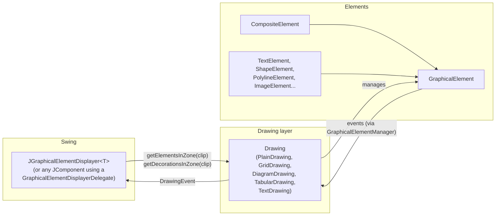
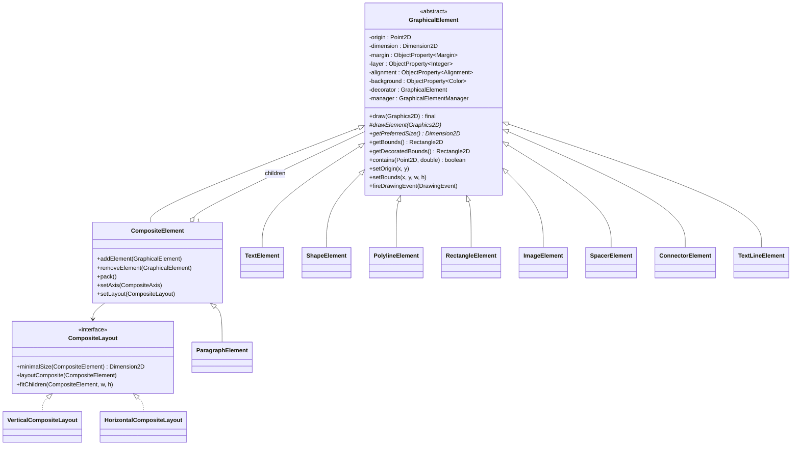
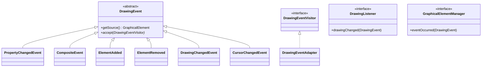
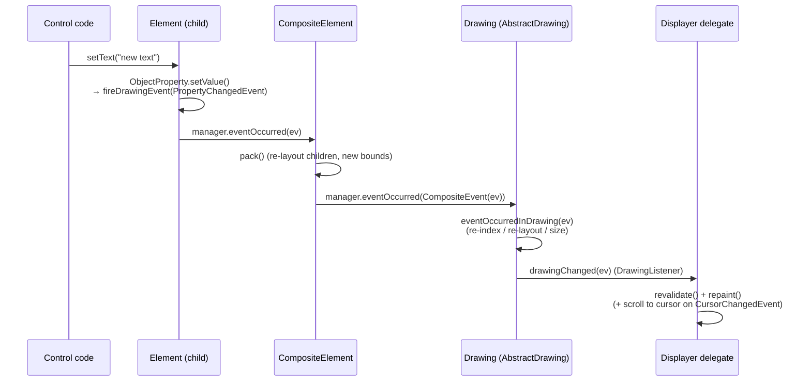
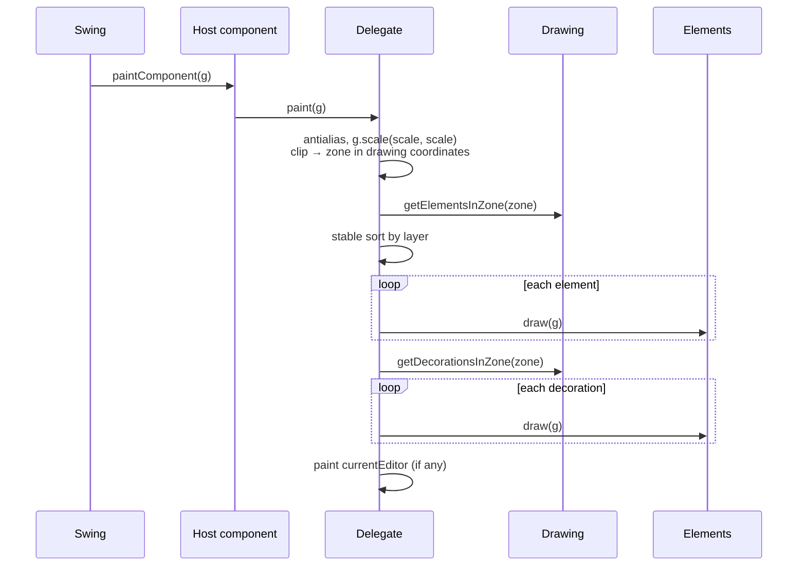
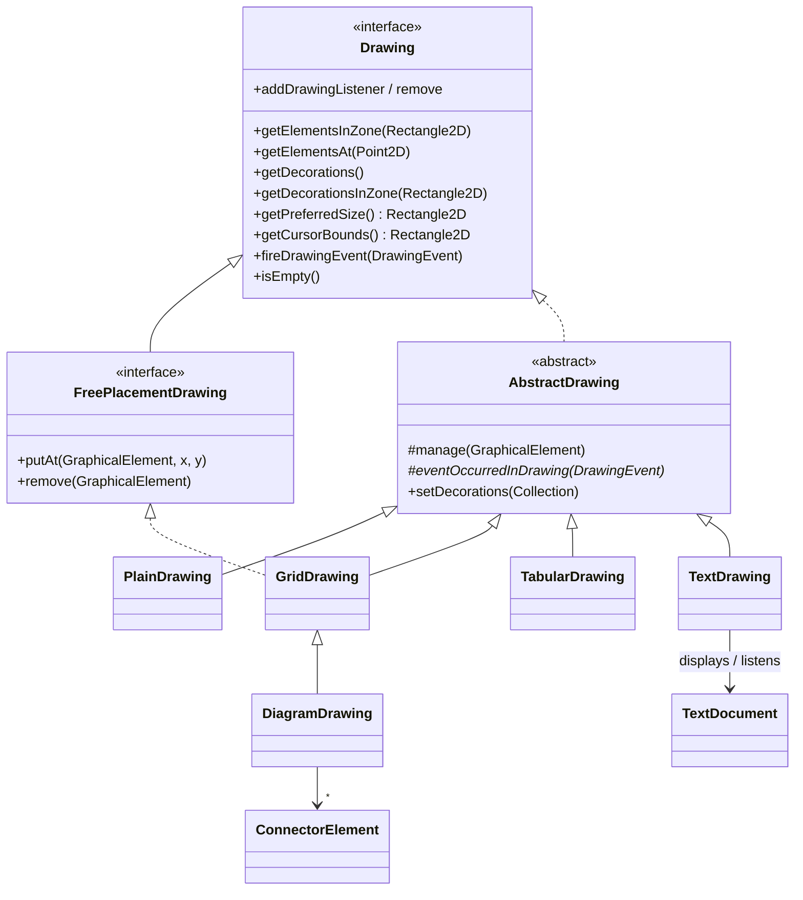
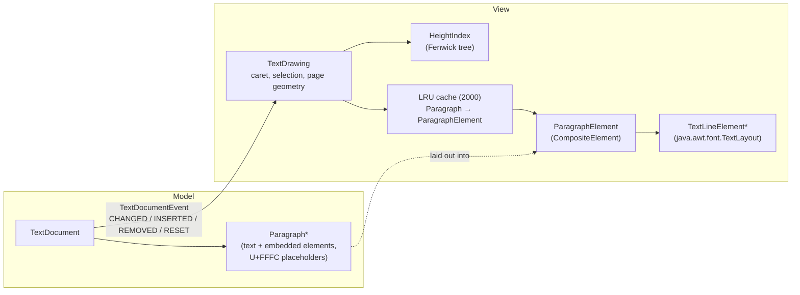
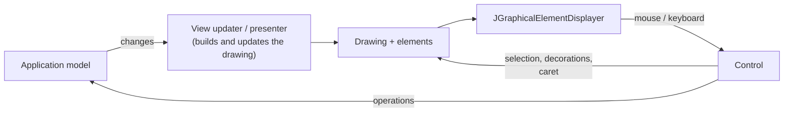
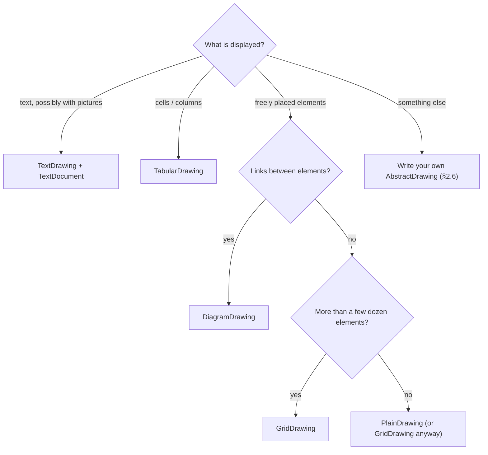

# View Toolkit

`org.qenherkhopeshef.viewtoolkit` is a library that gives you a solid base for building complex Swing **components**, typically views of a composite model.

It provides tools to:

- define a display made of `GraphicalElement`s;
- map between screen coordinates and model coordinates;
- abstract the layout of elements, with a different solution for each kind of display (text, free graphics, diagrams, tables...).

The toolkit knows nothing about the application's data. It only deals with *graphical elements*, the *drawings* which organise them, and the Swing component which displays a drawing. The application provides the rest: the code which builds the drawing from its model, and the code which turns mouse and keyboard events into operations.

The toolkit has no dependency outside the JDK and `qenherkhopeshefUtils` itself (`DoubleDimensions`, `GraphicsUtils`, `BusyInterface`, `ReversibleMultiHashMap`). It needs Java 17 or later (records, switch expressions, pattern matching).

## Contents

1. [Architecture](#1-architecture)
2. [Programmer's guide](#2-programmers-guide)
3. [Demos](#3-demos)
4. [Known limitations and notes](#4-known-limitations-and-notes)

---

## 1. Architecture

### 1.1 The three main concepts



| Concept | Class(es) | Responsibility |
| --- | --- | --- |
| **Graphical element** | `drawing.element.GraphicalElement` and subclasses | Something that can be drawn: a text, a shape, a line, a picture, or a composite of other elements. It knows its position, its preferred size, and how to paint itself. Its properties fire events when they change. |
| **Drawing** | `drawing.Drawing`, `drawing.AbstractDrawing` and subclasses | A collection of elements which can quickly find the elements in a given zone. It *manages* its elements: it is notified when they change, updates its own structures (spatial index, layout...), and forwards the events to its listeners. It also provides *decorations* (caret, selection, handles...). |
| **Displayer** | `JGraphicalElementDisplayer`, `GraphicalElementDisplayerDelegate` | The Swing side. It asks the drawing only for the elements in the visible area, paints them, handles scaling and scrolling, and repaints when the drawing changes. |

Package layout:

```text
org.qenherkhopeshef.viewtoolkit
├── JGraphicalElementDisplayer          Swing component (thin wrapper)
├── GraphicalElementDisplayerDelegate   the actual displaying machinery
├── drawing
│   ├── Drawing, AbstractDrawing        drawing contract and base class
│   ├── FreePlacementDrawing            "put an element at (x,y)" contract
│   ├── PlainDrawing                    naive list, for small drawings
│   ├── GridDrawing                     spatially indexed free placement
│   ├── diagram                         DiagramDrawing, ConnectorElement, ConnectorEnd
│   ├── tabularDrawing                  TabularDrawing (cells, many columns), cursor
│   ├── textOriented                    TextDocument (model) + TextDrawing (view)
│   ├── element                         GraphicalElement and the standard elements
│   │   ├── layout                      CompositeLayout strategies
│   │   └── property                    Property, ObjectProperty
│   └── event                           DrawingEvent hierarchy, visitor, listeners
└── demo                                three demo applications + launcher
```

### 1.2 Graphical elements



**Geometry.** An element has an *origin* (top-left corner, in its parent's coordinate system) and a *size*. As long as `setBounds()` has never been called, the size follows `getPreferredSize()`. Once a container (a composite, a table cell) has assigned explicit bounds, the size is fixed, and the element is drawn in that room according to its `Alignment` (`LEFT`, `RIGHT`, `CENTERED`, `FILL`; horizontal only).

- `getBounds()`: the element's own rectangle.
- `getDecoratedBounds()`: the bounds plus the *margin*. The margin is the room around the element when it is placed in a container; it does not belong to the element. The default margin is 2 units on every side; use `Margin.NONE` for none.
- `getTotalPreferredSize()`: preferred size plus margin, which layouts use.

**Drawing.** `draw(Graphics2D)` is a final template method. It fills the background (if not transparent), translates the graphics context to the element origin (plus the alignment shift), draws the optional *decorator* element, then calls the abstract `drawElement(Graphics2D)`. In `drawElement`, the element is always at (0,0): it never deals with its own position.

**Hit testing.** `contains(Point2D, tolerance)` is a precise hit test, in the parent's coordinates. The default tests the bounding box; non-rectangular elements (`ShapeElement`, `PolylineElement`, `ConnectorElement`) redefine it.

**Layers.** Each element has an integer layer. Displayers draw elements by increasing layer, keeping the drawing's own order inside a layer (`DiagramDrawing` puts connectors on layer −1, under the nodes).

**Standard elements:**

| Element | Use |
| --- | --- |
| `TextElement` | one line of text, with font, colour and inner margin (padding) |
| `ShapeElement` | any `java.awt.Shape`, filled and/or stroked; coordinates are local (≥ 0) |
| `PolylineElement` | open or closed line; points given in *parent* coordinates, origin recomputed automatically; editable point by point |
| `RectangleElement` | an outlined rectangle filling its bounds (preferred size 0×0: give it bounds) |
| `ImageElement` | a `BufferedImage`, optionally scaled down to fit a box |
| `SpacerElement` | invisible element with a fixed size, to reserve room |
| `CompositeElement` | container laid out by a `CompositeLayout` (vertical by default) |
| `ConnectorElement` | a link between two elements, with arrow heads and labels (see §1.5) |

### 1.3 Properties and events

Element attributes that matter for display are stored in `ObjectProperty<T>` objects instead of plain fields. An `ObjectProperty`:

- holds an immutable, non-null value with value semantics (`equals` is used to detect changes);
- knows whether it is *geometric* (whether a change can alter the element's size);
- when `setValue()` changes the value, it fires a `PropertyChangedEvent` on its element.

Geometric changes which are not properties (origin, bounds, polyline points, connector routes) fire `PropertyChangedEvent`s with pseudo-properties (`BoundsProperty`, `DecoratorProperty`, ...).

The event hierarchy uses a visitor:



There are two listener interfaces, on purpose:

- `GraphicalElementManager` is the *inner* interface: the object which contains an element (a drawing or a composite). Each element has at most one manager, set by its container (`AbstractDrawing.manage()`, `CompositeElement.addElement()`).
- `DrawingListener` is the *outer* interface: whoever watches the drawing (the displayer, the application).

`DrawingEventAdapter` routes every `visitXXX` method to `visitDefault()`, so a listener only redefines the cases it cares about.

#### Event flow



An element placed directly in a drawing skips the composite step. In `eventOccurredInDrawing`, a drawing usually updates its structures and then calls `fireDrawingEvent(ev)`. Drawings which move elements themselves while reacting to an event (`TabularDrawing`, `GridDrawing.putAt`) use a flag (`beingChanged`, `muted`) to ignore the events they cause.

### 1.4 Displaying: `JGraphicalElementDisplayer` and its delegate

`GraphicalElementDisplayerDelegate<T extends Drawing>` does the whole job. It is attached to a *host* `JComponent`, and the host forwards a few calls to it (`getPreferredSize`, `paintComponent`, the `Scrollable` methods). `JGraphicalElementDisplayer<T>` is a ready-made `JPanel` host.

The toolkit offers both because inheriting from `JGraphicalElementDisplayer` exposes the whole drawing API in your component's public interface. If you would rather keep it hidden, or your component must extend another class, use the delegate as a private field (see §2.7).

Painting:



Because only the visible zone is requested, the displayer can show huge drawings, provided the drawing answers `getElementsInZone` efficiently.

Other services of the delegate/displayer:

- **Scale.** `setScale(double)` zooms. Mouse positions must be converted with `toDrawingPoint(Point)`, and rectangles with `toComponentRectangle` / `toDrawingRectangle`.
- **Scrolling.** It implements `Scrollable`: `setUnitIncrement`, and `setTracksViewportWidth(true)` makes the component as wide as the viewport (a text drawing then uses that width as its line width). When the drawing is smaller than the viewport, the component fills it.
- **Cursor following.** On a `CursorChangedEvent`, or when `showCursor()` is called, it scrolls to `drawing.getCursorBounds()`.
- **Busy state.** `setBusy` / `setAdvance` are forwarded to an optional `BusyInterface`.
- **Transient editor.** `setCurrentEditor(JComponent)` paints a component over the drawing.
- **Lifecycle.** The delegate installs only one listener, a `DrawingListener` on the drawing. Call `dispose()` if the host is thrown away while the drawing lives on.

### 1.5 The drawings



`AbstractDrawing` provides listener management, decorations (`setDecorations`), and the element-manager glue: every method which adds an element must call `manage(elt)`, and the subclass reacts to element events in `eventOccurredInDrawing`.

| Drawing | Structure | Cost of `getElementsInZone` | Typical use |
| --- | --- | --- | --- |
| `PlainDrawing` | a list | O(n) | experiments, a handful of elements |
| `GridDrawing` | free placement, hashed grid of cells | ~ number of cells in the zone | free drawings with many elements |
| `DiagramDrawing` | `GridDrawing` + connectors following their nodes | same | graphs, UML diagrams |
| `TabularDrawing` | elements in cells (column, row, horizontal span) | binary search on columns | trees and grids with very many *columns* (originally the Ramsès tree editor) |
| `TextDrawing` | wrapped paragraphs with embedded elements, caret, selection | O(log n) | texts of any length |

#### `GridDrawing`

The plane is split into cells (100×100 by default; choose a cell size close to the size of a typical element). Each element is registered in every cell its decorated bounds intersect. Elements covering more than 64 cells go to a separate "large elements" list, which is always searched. When a managed element changes (moves, grows), it is re-indexed automatically, so moving an element is just `elt.setOrigin(x, y)`.

Elements are returned in drawing order: by layer, then by insertion order, which `bringToFront` / `sendToBack` change. `setMinimalSize` gives an empty canvas a size.

#### `DiagramDrawing`, `ConnectorElement`

A `GridDrawing` (150×150 cells) which also tracks `ConnectorElement`s per node. Any element can be a node. When a node changes (it is moved, or its content grows), the drawing calls `updateGeometry()` on its connectors, which re-routes them:

- a straight segment between the two boxes' centres, clipped at their borders;
- several connectors between the same two nodes are spread apart (`setOffset`);
- a connector from a node to itself is drawn as a loop.

Ends (`ConnectorEnd`): `NONE`, `OPEN_ARROW`, `HOLLOW_TRIANGLE`, `HOLLOW_DIAMOND`, `FILLED_DIAMOND`. A connector can be dashed and carries up to three labels (middle, near source, near target). Removing a node removes its connectors.

#### `TabularDrawing`

Elements are added with `add(elt, column, row, colSpan, rowSpan)`. Column widths and row heights grow to fit the elements' preferred sizes, then every element gets the bounds of its cell(s) (`fitCells`). When an element grows, only its column/row is adjusted (`relayout`).

For bulk loading, wrap the additions in `setBeingChanged(true)` … `setBeingChanged(false)`: the full layout runs once, at the end, and reports progress to an optional `AdvancementListener`. A `TabularDrawingCursor` can be shown as a vertical bar decoration.

#### `TextDrawing` and `TextDocument`

This is the most elaborate drawing. Unlike the others, its content is not a set of managed elements: it is a **model**, `TextDocument`, which the drawing listens to.



- **Model.** A `TextDocument` is a list of `Paragraph`s; it always contains at least one. A paragraph is a string in which each `U+FFFC` (object replacement character) stands for an embedded `GraphicalElement`. Positions are `TextPosition(paragraph, offset)` records, where offsets are gaps between characters. You edit through the document (`insertText`, `insertElement`, `delete`, `setText`, `setContent(Builder)`), and it fires `TextDocumentEvent`s.
- **Lazy layout.** A paragraph is laid out (`ParagraphElement`, built with `LineBreakMeasurer`) only when it is displayed or queried. Until then its height is *estimated* from its length.
- **Fenwick tree.** `HeightIndex` keeps every paragraph height (exact or estimated). The top of paragraph *i*, and the paragraph at a given *y*, cost O(log n).
- **Bounded memory.** At most 2000 laid-out paragraphs are kept, in an LRU cache.
- **Background refinement.** `layoutPendingParagraphs(maxNanos)`, called repeatedly (for instance from a Swing `Timer`), replaces estimates with exact heights, so the scroll bar becomes more and more accurate. `getLayoutCompletion()` gives progress. Laying out a paragraph never moves the text *above* it.
- **Embedded elements** go through `TextAttribute.CHAR_REPLACEMENT` (`EmbeddedElementGraphic`). The standard Java text classes then handle line breaking, hit testing and carets around them as if they were big characters sitting on the baseline.
- **Editor queries.** `getPositionAt(Point2D)`, `getCaretRectangle`, `getPositionAbove/Below(pos, x)`, `getLineStart/End`, caret and selection management (`setCaret`, `moveCaret(pos, extend)`, `select`, `selectAll`). The caret and the selection highlight are produced as decorations, only for the visible zone.
- **Configuration.** Font, colours, page width, page margin, paragraph spacing. Changing any of these invalidates the layout.

Keyboard and mouse handling is left to the application (see the text editor demo).

### 1.6 Coordinate systems

| System | Unit / origin | Conversion |
| --- | --- | --- |
| Component (mouse events, `scrollRectToVisible`) | pixels, component top-left | `displayer.toDrawingPoint(Point)`, `toDrawingRectangle`, `toComponentRectangle` |
| Drawing | drawing units; 1 unit = 1 pixel at scale 1 | — |
| Parent | element `getBounds()` / `setOrigin()` are in the parent's system: the drawing, or the enclosing composite | add the composite's origin when going up |
| Local | inside `drawElement`, the element is at (0,0) | done by `draw()` |

`PolylineElement` and `ConnectorElement` accept and return points in *parent* coordinates, and store them locally.

---

## 2. Programmer's guide

### 2.1 Recommended organisation

All three demos follow the same pattern, which is also the recommended one:



- The **model** is yours (or `TextDocument` for text).
- The **view updater** (or presenter) builds elements from the model and keeps them up to date. In the UML demo, this is `UmlDiagramPresenter`.
- The **control** translates input into model operations (or into pure view operations such as selection), and uses the drawing's geometric queries to do so.

### 2.2 A minimal example

```java
GridDrawing drawing = new GridDrawing();
drawing.setMinimalSize(800, 600);

TextElement hello = new TextElement("Hello, world", new Font("Serif", Font.PLAIN, 24));
drawing.putAt(hello, 40, 40);

ShapeElement disc = new ShapeElement(new Ellipse2D.Double(0, 0, 60, 60));
disc.setColor(new Color(255, 200, 40));
disc.setLineColor(Color.DARK_GRAY);
drawing.putAt(disc, 300, 120);

JGraphicalElementDisplayer<GridDrawing> display = new JGraphicalElementDisplayer<>(drawing);
JFrame frame = new JFrame("Demo");
frame.getContentPane().add(new JScrollPane(display));
frame.setSize(640, 480);
frame.setVisible(true);
```

From then on, *modifying an element is enough*: `hello.setText("Bye")` or `disc.setOrigin(10, 10)` re-indexes the element and repaints the display.

### 2.3 Choosing a drawing



### 2.4 Writing a graphical element

Extend `GraphicalElement` and provide `drawElement` and `getPreferredSize`. Store display-relevant attributes in `ObjectProperty`s, so that changes propagate. Mark properties which change the size as *geometric*.

```java
public class DiscElement extends GraphicalElement {
    private final ObjectProperty<Double> radius = new ObjectProperty<>("radius", this, 10.0, true);
    private final ObjectProperty<Color> color = new ObjectProperty<>("color", this, Color.RED, false);

    @Override
    protected void drawElement(Graphics2D g) {
        double r = radius.getValue();
        g.setColor(color.getValue());
        g.fill(new Ellipse2D.Double(0, 0, 2 * r, 2 * r));   // local coordinates: we are at (0,0)
    }

    @Override
    public Dimension2D getPreferredSize() {
        double d = 2 * radius.getValue();
        return new DoubleDimensions(d, d);
    }

    /// Precise hit test (point in parent coordinates).
    @Override
    public boolean contains(Point2D p, double tolerance) {
        Rectangle2D b = getBounds();
        double r = radius.getValue();
        return p.distance(b.getMinX() + r, b.getMinY() + r) <= r + tolerance;
    }

    public void setRadius(double r) { radius.setValue(r); }
    public void setColor(Color c)   { color.setValue(c); }
}
```

Guidelines:

- Your bounds must cover all the ink you draw: never paint outside `(0,0)–getPreferredSize()` (or the bounds you were given). Being partly visible is fine; *overflowing your bounds* is not, because the toolkit only knows the element through its bounds:
  - on a partial repaint (typically, the strip exposed by scrolling), the drawing only returns elements whose bounds intersect the repainted zone, so overflowing ink is erased there and not redrawn: it appears cut along a straight line;
  - the drawing's size is computed from the bounds, so ink beyond them may be impossible to scroll to;
  - hit testing gathers candidates by bounds, so clicks on the overflowing part miss the element.

  Elements which need room around their geometry (thick lines, arrow heads, labels) include it in their size, as `PolylineElement` and `ConnectorElement` do.
- If you cache the preferred size, reset the cache *before* calling `setValue` on a geometric property, as `TextElement` does: listeners will ask for the new size during the event.
- `ObjectProperty` values must be immutable and non-null.
- For state which is not a property (a list of points...), fire `new PropertyChangedEvent(this, SOME_PSEUDO_PROPERTY)` yourself.

### 2.5 Composites

```java
CompositeElement box = new CompositeElement();          // vertical by default
box.setMargin(Margin.NONE);
box.setBackground(new Color(255, 250, 222));

TextElement title = new TextElement("Title", new Font("SansSerif", Font.BOLD, 13));
title.setAlignment(Alignment.CENTERED);
box.addElement(title);
box.addElement(new TextElement("first line"));
box.addElement(new TextElement("second line"));
box.pack();                                             // compulsory after the last addElement

drawing.putAt(box, 100, 100);
```

- `pack()` lays out the children and sets the composite's bounds to its minimal size. Call it after building the composite (and after `removeElement`).
- `setBounds()` on a composite stretches its children along the cross axis. Their `Alignment` then decides where they are drawn inside the extra room. This is how the title above is centred.
- Once packed, a composite repacks *itself* whenever a child fires an event, and forwards a `CompositeEvent` to its own manager. Changing a child's text therefore resizes the box, and (in a `DiagramDrawing`) re-routes its connectors.
- Composites can be nested (`ClassBoxElement` in the UML demo is a composite of three composites).
- Use `setAxis(CompositeAxis.HORIZONTAL)` for a row, or `setLayout(...)` with your own `CompositeLayout` (three methods: `minimalSize`, which must not modify anything; `layoutComposite`; `fitChildren`).
- To draw a frame or separators around the children, redefine `drawElement`, call `super.drawElement(g)`, then draw on top.

### 2.6 Writing a drawing

Extend `AbstractDrawing`:

```java
public class MyDrawing extends AbstractDrawing {
    public void add(GraphicalElement e) {
        // ... store e in your structure ...
        manage(e);                          // compulsory: e will report its changes to us
        fireDrawingEvent(new ElementAdded(e));
    }

    @Override public Collection<GraphicalElement> getElementsInZone(Rectangle2D zone) { ... }
    @Override public Rectangle2D getPreferredSize() { ... }   // starts at (0,0)
    @Override public Rectangle2D getCursorBounds() { return null; }
    @Override public boolean isEmpty() { ... }

    @Override
    protected void eventOccurredInDrawing(DrawingEvent ev) {
        // update your structures (index, layout, cached size...), then:
        fireDrawingEvent(ev);
    }
}
```

The `AbstractDrawing` javadoc shows the guard-flag pattern to use when re-laying out elements from inside `eventOccurredInDrawing`.

Optionally redefine `getDecorations()` / `getDecorationsInZone()`, for instance to compute a caret on the fly, as `TabularDrawing` and `TextDrawing` do. Redefining `getDecorationsInZone` is worthwhile when decorations can be numerous (a selection over a long text).

### 2.7 Embedding without inheritance: the delegate

```java
public class MyView extends JComponent implements Scrollable {
    private final GraphicalElementDisplayerDelegate<GridDrawing> delegate;

    public MyView(GridDrawing drawing) {
        delegate = new GraphicalElementDisplayerDelegate<>(this, drawing);
        setOpaque(true);
        setBackground(Color.WHITE);
    }

    @Override public Dimension getPreferredSize() {
        // May be called by a superclass constructor, before the delegate exists.
        return delegate == null ? super.getPreferredSize() : delegate.getPreferredSize();
    }

    @Override protected void paintComponent(Graphics g) {
        g.setColor(getBackground());
        g.fillRect(0, 0, getWidth(), getHeight());
        delegate.paint(g);
    }

    @Override public Dimension getPreferredScrollableViewportSize() { return delegate.getPreferredScrollableViewportSize(); }
    @Override public int getScrollableUnitIncrement(Rectangle r, int o, int d) { return delegate.getScrollableUnitIncrement(r, o, d); }
    @Override public int getScrollableBlockIncrement(Rectangle r, int o, int d) { return delegate.getScrollableBlockIncrement(r, o, d); }
    @Override public boolean getScrollableTracksViewportWidth() { return delegate.getScrollableTracksViewportWidth(); }
    @Override public boolean getScrollableTracksViewportHeight() { return delegate.getScrollableTracksViewportHeight(); }

    // Expose only what your users need, e.g. a zoom:
    public void zoom(double factor) { delegate.setScale(delegate.getScale() * factor); }
}
```

### 2.8 Interaction: mouse, hit testing, decorations

**Always convert mouse coordinates first:**

```java
Point2D p = display.toDrawingPoint(mouseEvent.getPoint());
```

**Hit testing** is done in two steps. The drawing gives *candidates* (by bounding box), and `contains` refines the result. Iterate backwards to find the topmost element, and express the tolerance in pixels by dividing by the scale:

```java
double t = 5 / display.getScale();
List<GraphicalElement> candidates = new ArrayList<>(drawing.getElementsInZone(
        new Rectangle2D.Double(p.getX() - t, p.getY() - t, 2 * t, 2 * t)));
for (int i = candidates.size() - 1; i >= 0; i--)
    if (candidates.get(i).contains(p, t))
        return candidates.get(i);
```

**Moving** an element in a `GridDrawing` / `DiagramDrawing` is just `elt.setOrigin(x, y)`: the drawing re-indexes it, re-routes connectors and repaints.

**Decorations** are elements which are displayed but are not part of the picture: selection handles, rubber bands, the line currently being drawn, carets. They are drawn above all elements, are never returned by `getElementsInZone`, and are not managed. With an `AbstractDrawing`, replace them as a whole:

```java
drawing.setDecorations(List.of(handle1, handle2, rubberBand));
drawing.setDecorations(List.of());        // remove them
```

Decorations whose size should stay constant on screen (handles) should be built with sizes divided by `display.getScale()`.

**Cursor.** If your drawing has a caret or cursor, return its area from `getCursorBounds()` and fire a `CursorChangedEvent` when it moves. The displayer will scroll to keep it visible.

### 2.9 Text editing with `TextDrawing`

```java
TextDocument document = new TextDocument();
TextDrawing drawing = new TextDrawing(document);
JGraphicalElementDisplayer<TextDrawing> display = new JGraphicalElementDisplayer<>(drawing);
display.setTracksViewportWidth(true);

// Fill the document (one event for the whole content):
TextDocument.Builder b = new TextDocument.Builder();
b.appendText("A first paragraph.\nA second one, with a picture: ");
b.appendElement(new ImageElement(image));
document.setContent(b);

// Wrap lines to the window width:
display.addComponentListener(new ComponentAdapter() {
    @Override public void componentResized(ComponentEvent e) {
        double w = display.getWidth() / display.getScale()
                 - drawing.getPageMargin().getTotalMarginWidth();
        drawing.setPageWidth(Math.max(150, w));
    }
});

// Refine paragraph heights in the background:
Timer timer = new Timer(25, e -> {
    if (!drawing.layoutPendingParagraphs(8_000_000L))   // 8 ms slices
        ((Timer) e.getSource()).stop();
});
drawing.addDrawingListener(e -> {
    if (drawing.getLayoutCompletion() < 1 && !timer.isRunning()) timer.start();
});
```

Editing commands go to the **document**, caret moves to the **drawing**:

```java
TextPosition end = document.insertText(drawing.getCaret(), "typed text");
drawing.moveCaret(end, false);

TextPosition pos = drawing.getPositionAt(display.toDrawingPoint(e.getPoint()));
drawing.moveCaret(pos, e.isShiftDown());      // shift-click extends the selection
```

Notes:

- `insertText` turns line feeds into paragraph breaks, tabs into four spaces, and drops other control characters and `U+FFFC`. Use `insertElement` / `Builder.appendElement` for embedded elements.
- Embedded elements are treated as immutable leaves: don't modify them once they are in the text. The same element instance may appear in several paragraphs (the demo shares four pictures among 100 000 paragraphs).
- When the background layout corrects heights *above* the visible area, the visible text moves. `TextEditorDemo.layoutInBackground()` shows how to compensate by scrolling.
- The `ParagraphElement`s returned by the drawing are views: don't modify them.

### 2.10 Checklist and pitfalls

- Every method of your drawing that adds an element must call `manage(elt)`. Otherwise changes to the element are not seen.
- Call `pack()` on composites after filling them.
- Convert mouse points with `toDrawingPoint` before any query. Divide pixel tolerances and handle sizes by the scale.
- An element belongs to at most one container (one manager). Don't put the same instance in two drawings or composites. Text embedding is the exception, because embedded elements are not managed.
- Avoid infinite recursion when your drawing moves elements in response to their events: use a guard flag.
- `getPreferredSize()` of a drawing should start at (0,0) and cover all elements. Elements at negative coordinates are not reachable by scrolling.
- Everything is Swing: create and modify drawings on the Event Dispatch Thread.

---

## 3. Demos

The demos live in `org.qenherkhopeshef.viewtoolkit.demo` (in `src/main`). They are proofs of concept, and examples of each kind of drawing. All three follow the model / drawing / control organisation of §2.1.

### 3.1 Running them

`ViewToolKitDemos` is a small launcher window with one button per demo. Each demo also has its own `main` method.

```bash
./gradlew :qenherkhopeshefUtils:classes
java -cp qenherkhopeshefUtils/build/classes/java/main org.qenherkhopeshef.viewtoolkit.demo.ViewToolKitDemos
# or, directly:
java -cp qenherkhopeshefUtils/build/classes/java/main org.qenherkhopeshef.viewtoolkit.demo.text.TextEditorDemo
java -cp qenherkhopeshefUtils/build/classes/java/main org.qenherkhopeshef.viewtoolkit.demo.picture.PictureDrawerDemo
java -cp qenherkhopeshefUtils/build/classes/java/main org.qenherkhopeshef.viewtoolkit.demo.uml.UmlDiagramDemo
```

(From an IDE, just run the `main` method of any of these classes.)

### 3.2 Demo 1: text editor (`demo.text`)

A simple word processor with embedded pictures, able to edit very long texts.

| Class | Role |
| --- | --- |
| `TextEditorDemo` | window, menus, status bar, background-layout timer, page width following the window |
| `TextEditorControl` | keyboard and mouse: typing, Backspace/Delete, arrows, Home/End, Page Up/Down, shift-selection, double-click (word) and triple-click (paragraph), cut/copy/paste of plain text |
| `SamplePictures` | pictures generated by program (a landscape `ImageElement`, a vector star `PolylineElement`), so the demo needs no image file |

What to try:

- *Insert > Sample picture / Vector star / Picture from file*. Any `GraphicalElement` can be embedded, not only bitmaps.
- *File > Generate long text…* with 100 000 paragraphs or more. The text appears immediately, because only the visible paragraphs are laid out. The status bar shows the proportion of exact heights growing as the background layout progresses.
- *File > Open text file…* opens a plain-text file (UTF-8, or Latin-1 as a fallback).
- *View > Bigger / Smaller text*, and resizing the window. Both re-wrap everything.

Toolkit features shown: `TextDocument`, `TextDrawing`, `TextDocument.Builder`, lazy layout and `layoutPendingParagraphs`, caret/selection decorations, `setTracksViewportWidth`, `ImageElement`, embedded elements.

### 3.3 Demo 2: picture drawer (`demo.picture`)

A small vector drawing program with open and closed lines.

| Class | Role |
| --- | --- |
| `PictureDrawerDemo` | window and toolbar (tools, colour, width, fill, front/back, delete, clear, zoom, "Add 10 000 random lines"), sample picture (a house and a path) |
| `PictureDrawerControl` | three tools. **Select**: click a line, drag it, drag a vertex handle, Delete. **Open line** / **Closed line**: click to add points; double-click, right-click or Enter to finish; clicking the first point closes the shape; Escape cancels; Backspace removes the last point. |

Toolkit features shown:

- `GridDrawing` with `PolylineElement`s. "Add 10 000 random lines" over a 5000×4000 area shows that the display and hit testing stay fast with many elements.
- Two-step hit testing (`getElementsInZone` + `contains` with a tolerance), topmost-first.
- **Decorations** for everything which is not part of the picture: the line being drawn, the rubber band, and the selection handles (sized independently of the zoom).
- Moving elements and points simply by changing them (`translate`, `setPoint`), with the grid re-indexing automatically.
- `bringToFront` / `sendToBack`, `setScale`.

### 3.4 Demo 3: UML class diagram displayer (`demo.uml`)

On the left, a class diagram written in a subset of PlantUML. On the right, the rendered diagram. *Render* (or menu-shortcut + Enter) parses the text. Class boxes can then be dragged around, and the connectors follow. The sample text describes the viewToolKit itself.

| Class | Role |
| --- | --- |
| `UmlParser` | reads `class` / `abstract class` / `interface` / `enum` declarations with optional `{ ... }` bodies (lines with `(` are operations), and relations such as `A <\|-- B`, `A <\|.. B`, `A "1" *-- "*" B : label`, `A o-- B`, `A --> B`, `A ..> B`. `'` starts a comment. Errors are reported with their line number, which is highlighted in the editor. |
| `UmlModel` | the tiny model: classes (kind, attributes, operations) and relations (ends, dashed, labels) |
| `ClassBoxElement` | a class box: a vertical `CompositeElement` of three compartments (name with optional stereotype, attributes, operations), each a composite of `TextElement`s. It draws its own frame and separators, and has a "selected" property. |
| `UmlDiagramPresenter` | the view updater. It builds the boxes and `ConnectorElement`s, and places the boxes with a simple layered layout: longest-path ranking (general classes and composition "wholes" above), cycles broken by DFS, then barycenter sweeps to reduce crossings. |
| `UmlDiagramDemo` | window, toolbar (zoom, automatic layout), drag control |

Toolkit features shown: `DiagramDrawing`, `ConnectorElement` with every `ConnectorEnd`, dashed lines, labels, parallel-connector spreading, nested `CompositeElement`s with `Alignment.CENTERED` and `SpacerElement`, and custom painting on top of a composite. Moving a box is just `setOrigin`: the drawing re-indexes it and re-routes its connectors.

### 3.5 Tests

Unit tests live in `src/test/java/org/qenherkhopeshef/viewtoolkit`: `GridDrawingTest`, `CompositeElementTest`, `DiagramDrawingTest`, `HeightIndexTest`, `TextDocumentTest`, `TextDrawingTest`, and `UmlParserTest` for the demo parser.

```bash
./gradlew :qenherkhopeshefUtils:test
```

---

## 4. Known limitations and notes

- `TabularDrawing.getElementsInZone` searches only the relevant *columns*, but all rows. It is designed for many columns, not many rows. Its `rowSpan` argument is currently ignored (rows are single-height).
- `TabularDrawing` and parts of the element package still use old-style `/** */` javadoc. They will be converted gradually.
- `RectangleElement` has a preferred size of 0×0: it is meant to receive explicit bounds (as a decorator, or a cursor).
- `Alignment` only applies horizontally.
- `TextElement` has an *inner margin* (padding) property which, as its javadoc notes, belongs in `GraphicalElement`.
